# 碳韧智网 GridRescue

> **极端天气配电网碳—韧性协同恢复决策 · 低碳保供预案工作台**  
> 面向第五届中国研究生“双碳”创新与创意大赛，建议主投 **赛道二 / 2.1 新型电力系统**。

GridRescue 是一个“**服务合同门控、证据承载**”的配电网灾害恢复数字孪生原型。系统不是先找一个碳排更低的数字，再解释为什么合理；而是要求每个候选恢复方案依次通过：

```text
Care 生命线服务合同 → Physics 配电网物理校验 → MRV 可复算碳证据
```

只有三门全部通过的候选，才进入推荐或比较。服务不等价、孤岛无成网电源、潮流不可行、证据缺失或文件被篡改时，系统保留失败记录并撤回相应主张。

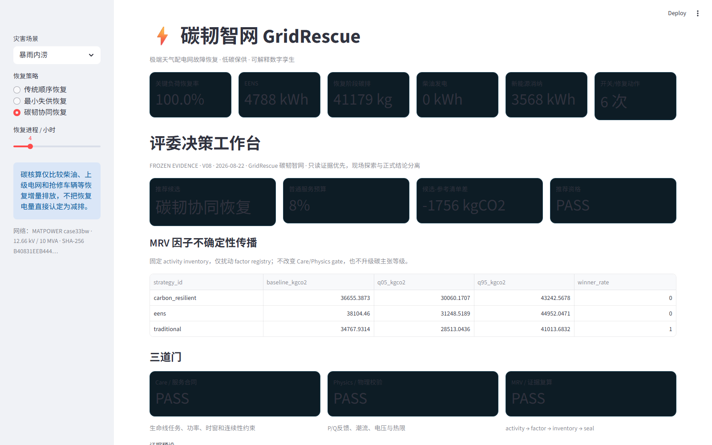

> 截图状态：暴雨内涝、碳韧协同恢复、T+4h；读取 2026-08-22 冻结证据。界面中的 `PASS` 表示对应门通过，仍须结合下述主张边界解释。

---

## 目录

- [1. 一页看懂项目](#1-一页看懂项目)
- [2. 系统解决什么问题](#2-系统解决什么问题)
- [3. 总体架构与端到端流程](#3-总体架构与端到端流程)
- [4. 五个核心创新](#4-五个核心创新)
- [5. 网络、场景与数据输入](#5-网络场景与数据输入)
- [6. 三种恢复策略与求解原理](#6-三种恢复策略与求解原理)
- [7. Care / Physics / MRV 三门原理](#7-care--physics--mrv-三门原理)
- [8. Pareto、批处理、风险与不确定性](#8-pareto批处理风险与不确定性)
- [9. 当前实验结果怎么读](#9-当前实验结果怎么读)
- [10. 仓库目录逐块说明](#10-仓库目录逐块说明)
- [11. 源码模块逐文件说明](#11-源码模块逐文件说明)
- [12. 脚本、测试、文档和产物索引](#12-脚本测试文档和产物索引)
- [13. 快速开始](#13-快速开始)
- [14. 五分钟评委演示路线](#14-五分钟评委演示路线)
- [15. MRV 证据包结构与验证](#15-mrv-证据包结构与验证)
- [16. 主张边界、局限与下一步](#16-主张边界局限与下一步)
- [17. 比赛提交材料索引](#17-比赛提交材料索引)
- [18. 单人主导执行与技术审计](#18-单人主导执行与技术审计)

---

## 1. 一页看懂项目

### 1.1 当前能力

| 项目 | 当前实现 |
|---|---|
| 配电网 | MATPOWER `case33bw`：33 节点、32 条常闭支路、5 条常开联络线 |
| 灾害场景 | 暴雨内涝、台风、极端高温 |
| 恢复策略 | 传统顺序恢复、最小失供恢复、碳韧协同恢复 |
| 能源资源 | 上级电网、光伏、储能、柴油机、抢修车辆 |
| 物理校验 | 多故障、孤岛、径向性、P/Q 潮流、电压、热限、线损反馈 |
| 服务合同 | 医院/关键负荷 `CareTask`：功率、时窗、deadline、连续时长、依赖、电压 |
| 碳证据 | activity → factor → inventory → reconciliation → manifest → seal → verifier |
| 批处理 | 36 条冻结可重放场景，108 条策略物理结果 |
| 风险 | P95、CVaR95、失败率、failure budget |
| 不确定性 | 500 次确定性 LHS 排放因子传播 |
| 展示 | Streamlit 八页评委决策工作台、冻结证据读取和 ZIP 下载 |
| 回归测试 | 2026-08-27 Wave11 开发树：`73 passed`；V08 冻结基线：`46 passed` |

### 1.2 最重要的主张边界

```text
gas_basis=CO2
unit=kgCO2
factor_data_class=E
time_step_h=1.0
strict_eligible=0
same_service_pass=false
claim_status=controlled_service_budget_inventory_difference
```

这意味着当前结果支持：**在 E 类合成压力场景、公开普通服务预算和当前碳边界下，比较策略的运行碳清单差异。**

当前结果不应表述为严格同服务减排证明。`SEALED` 和 `Verification=PASS` 表示文件完整性、内部引用和方程复算通过，不表示现场实测或第三方核证。

### 1.3 项目价值

GridRescue 的重点不是“报一个更低的碳数字”，而是规定：

1. 生命线服务满足什么合同；
2. 恢复方案是否真正符合配电网物理；
3. 碳清单是否能被独立复算；
4. 失败场景是否仍留在分母和证据链中；
5. 最终数字在什么条件下才有资格被相信。

对运维人员而言，输出不是一个脱离约束的“冠军方案”，而是一条可选择的服务—碳预算前沿：在公开普通服务预算内，查看关键服务、普通服务 EENS、物理可行性和运行碳清单的交换关系；预算不可接受时保留参考策略，不强行推荐碳韧候选。这样把“低碳是否值得这项服务让步”变成可追问的工程决策。

---

## 2. 系统解决什么问题

极端天气下，配电网恢复不是单一的“尽快送电”问题，而是五类约束同时存在：

1. **拓扑约束**：故障支路退出，联络线闭合时必须保持径向结构；
2. **资源约束**：上级电网、PV、BESS、柴油机和抢修队的容量有限；
3. **服务约束**：医院 ICU、手术、冷链、通信等任务有时窗和连续性；
4. **物理约束**：恢复后仍要满足 P/Q 平衡、电压、热限和孤岛成网条件；
5. **证据约束**：低碳结论必须能追溯到活动量、排放因子、清单和原始动作。

传统方案容易出现两种误判：

- **少供电伪低碳**：因为普通负荷多停了一段时间，所以清单碳排更低；
- **数学可行、物理不可行**：调度表平衡了，但真实径向潮流、电压或孤岛资源不满足。

GridRescue 用 Care、Physics、MRV 三门把这两类误判显式阻断，并把失败点写入 CSV/JSON，而不是从结果里删除。

---

## 3. 总体架构与端到端流程

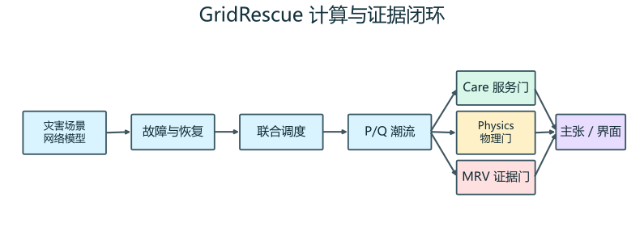

### 3.1 四层架构

| 层 | 作用 | 主要位置 |
|---|---|---|
| 输入层 | 网络、灾害、排放因子、CareTask、资源配置 | `data/`、`case33_data.py`、`scenarios.py`、`care.py` |
| 求解层 | 故障状态、恢复顺序、联络线、资源调度、潮流反馈 | `faults.py`、`restoration.py`、`dispatch.py`、`powerflow.py`、`pipeline.py` |
| 门控层 | Care 合同、Physics 校验、孤岛护照、MRV、风险 | `care.py`、`islands.py`、`mrv.py`、`risk.py` |
| 输出层 | CSV/JSON/Markdown、图表、Streamlit、提交 ZIP | `artifacts/`、`docs/assets/`、`app.py`、`scripts/` |

### 3.2 单场景数据流

```text
1. build_ieee33() 构造 33 节点网络
2. get_scenario() 读取灾害故障、修复时长和环境参数
3. make_plan() 生成修复顺序和联络线动作
4. dispatch_resources_spatial() 逐节点/逐孤岛调度资源
5. validate_dispatch() 对 24 个小时执行径向 P/Q 潮流
6. pipeline 将线损和组件服务上限反馈回调度，迭代收敛
7. evaluate_care_tasks() 检查生命线任务
8. build_island_passports() 记录每个非根孤岛的能力和失败原因
9. calculate_metrics()/calculate_carbon() 生成服务和清单指标
10. write_mrv_bundle() 写证据；verify_mrv_bundle() 独立复核
11. app.py 展示冻结证据和现场探索结果
```

### 3.3 调度—潮流闭环

调度优化先给出上级电网、PV、BESS、柴油和负荷服务量；潮流模块随后检查这个方案在真实网络拓扑上的电压、支路载流和损耗。若潮流发现线损或组件可服务上限与调度假设不一致，`pipeline.py` 将反馈值送回调度重新求解。

默认最多反馈 8 轮，最大残差不高于 `0.10 kW` 时视为收敛。这样避免“调度表能平衡，但放到线路上就过载或低压”。

---

## 4. 五个核心创新

### 4.1 CareTask：把生命线服务写成机器可检查的合同

每个任务不是一个抽象“医院权重”，而是一组明确字段：

- 所在节点；
- 最低功率；
- 服务时窗；
- deadline；
- 最小连续时长；
- 前置依赖；
- 任务级最低/最高电压；
- 数据等级。

代码：[`src/gridrescue/care.py`](src/gridrescue/care.py)  
测试：[`tests/test_care.py`](tests/test_care.py)

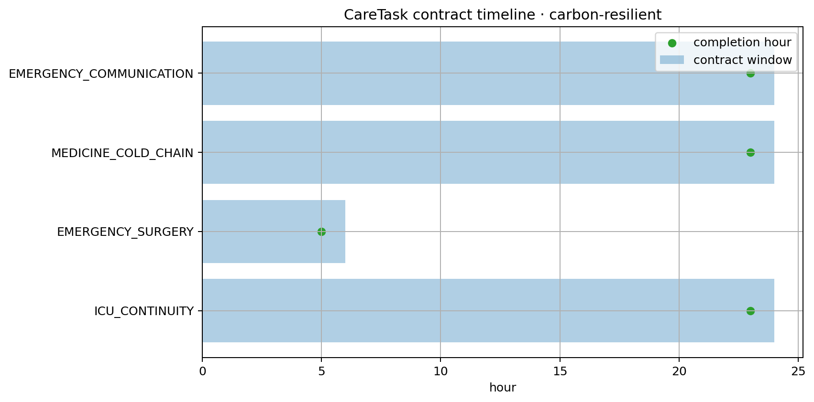

> 图中四个任务是 E 类合成赛事模板，用于展示合同机制，不代表医院实测数据或临床标准。

### 4.2 Physics：候选必须重新通过网络物理

每个恢复候选都会重新检查：

- 故障支路是否仍被隔离；
- 联络线闭合后是否保持径向；
- 每个孤岛是否有真实的 GFM/黑启动候选；
- 节点 P/Q 是否平衡；
- 最低电压是否越界；
- 支路是否超过热限；
- 潮流是否收敛；
- 线损是否已反馈到调度。

无成网电源的孤岛标记为 `NO_GFM/BLOCKED`，系统不注入虚拟 slack 掩盖功率缺口。

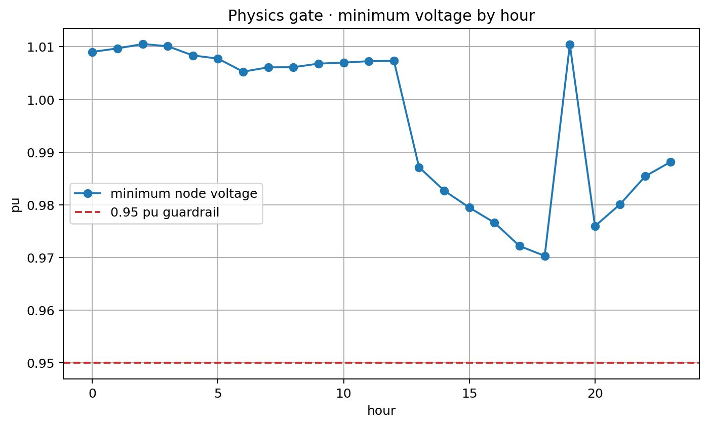

> 图源：2026-08-22 V08 暴雨冻结证据。0.95 pu 为当前工程 guardrail；逐节点证据在 `powerflow_nodes_*.csv`。

### 4.3 MRV：从碳数字追溯到活动账和文件哈希

系统生成版本化排放因子快照、逐时活动账、逐时排放清单、分项对账、动作 hash 链、manifest、evidence index 和 seal。独立 verifier 会重新检查：

- 文件 SHA-256；
- 行级 semantic hash；
- `run_id` 和跨表外键；
- `activity × factor = emission`；
- 分项之和与清单总量；
- 动作链 terminal hash；
- `time_step_h=1.0`；
- claim gate 一致性。

代码：[`src/gridrescue/mrv.py`](src/gridrescue/mrv.py)  
测试：[`tests/test_mrv.py`](tests/test_mrv.py)、[`tests/test_app_mrv.py`](tests/test_app_mrv.py)

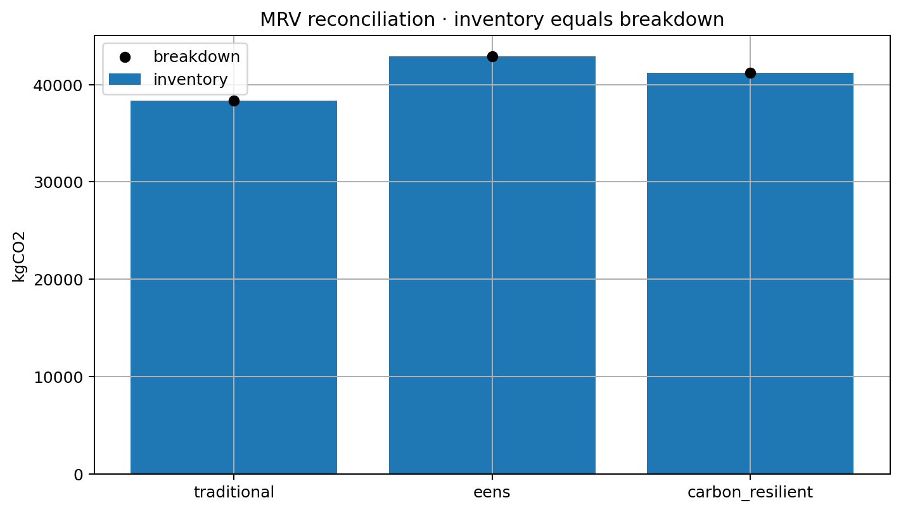

### 4.4 受控服务 Pareto：把服务让步公开，而不是藏起来

系统先按医院、其他关键负荷、普通负荷做词典序锚点，再只允许普通负荷在公开的 `ε` 预算内让步。每个 ε 点都重跑调度、潮流、Care 和 Physics，失败点写入 `pareto_failures.csv`。

当前主张状态是：

```text
controlled_service_budget_inventory_difference
```

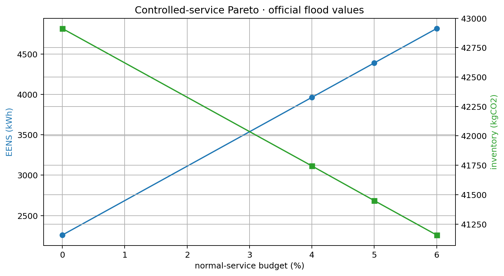

> 该图展示普通服务预算与 EENS/运行碳清单的权衡；它不支撑严格同服务减排表述。

### 4.5 失败可见、可重放、保留分母

36 条冻结场景都带固定 seed、canonical payload、SHA-256 `scenario_id` 和失败记录。Monte Carlo 或严格合同运行中，单个策略失败只会形成失败行，不会中止整个批次，也不会被填成 0。

台风严格合同的失败被保留，是系统诚实阻断不合格主张的反例，不是需要美化掉的数据。

---

## 5. 网络、场景与数据输入

### 5.1 case33bw 配电网

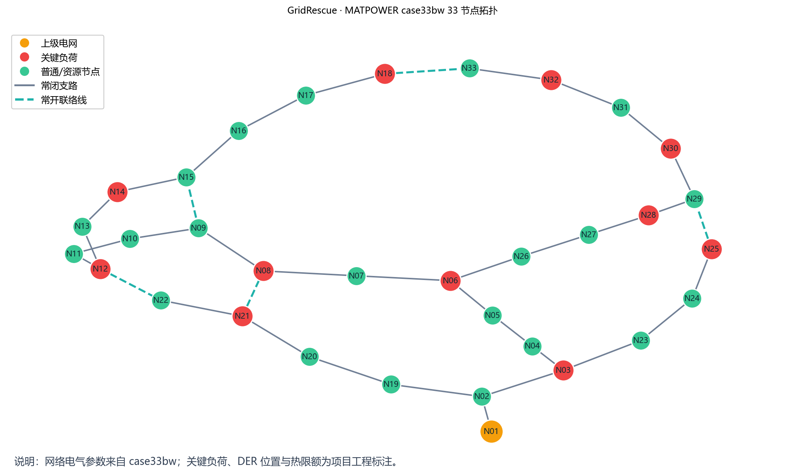

图中：

- 实线：32 条常闭支路；
- 虚线：5 条常开联络线；
- 橙色节点：上级电网根节点；
- 红色节点：项目工程标注的关键负荷；
- 绿色节点：普通负荷或 DER 节点。

网络电气参数来自 [`data/case33bw.m`](data/case33bw.m)；内置快照和 SHA-256 绑定在 [`src/gridrescue/case33_data.py`](src/gridrescue/case33_data.py)。DER 位置、关键负荷等级和支路热限额是项目工程假设，在网络 manifest 中显式标注。

### 5.2 三类灾害

| 场景 | 主要影响 | 模型字段 |
|---|---|---|
| 暴雨内涝 | 多支路受损、抢修时间延长、车辆里程增加 | failed branches、repair hours、crew distance |
| 台风 | 更强的多点故障和光伏降额 | fault set、PV derating、repair duration |
| 极端高温 | 负荷抬升、晚峰增强、资源压力增大 | temperature、load profile、grid factor multiplier |

实现位置：[`src/gridrescue/scenarios.py`](src/gridrescue/scenarios.py)。所有逐时负荷、PV 和 grid carbon profile 都由固定 seed 生成，可复现但不外推为真实灾害概率。真实天气校准样本见 [`data/weather/`](data/weather/)，当前仅作为观测天气输入，不绑定真实馈线停电回放。

### 5.3 36 条冻结场景 catalog

```text
3 灾种 × 3 强度 × 4 固定复本 = 36 条场景
36 场景 × 3 策略 = 108 条物理策略结果
```

位置：[`artifacts/wave10/catalog/`](artifacts/wave10/catalog/)  
批处理结果：[`artifacts/wave10/batch36/`](artifacts/wave10/batch36/)  
生成代码：[`src/gridrescue/scenario_catalog.py`](src/gridrescue/scenario_catalog.py)

### 5.4 排放因子

`data/factor_registry.csv` 同时保留两类记录：V08/Wave10 冻结回放使用的 E 类合成演示因子，以及可供新实验显式选择的生态环境部 2023 官方 O 类电力平均因子（全国 0.5306、华中区域 0.5271、湖北省 0.4044 kgCO2/kWh）。官方因子接入说明见 [`docs/official_factor_adoption_2023.md`](docs/official_factor_adoption_2023.md)；选择官方行不会悄悄改写历史 bundle。

注册表位置：[`data/factor_registry.csv`](data/factor_registry.csv)。当前统一边界：

- 气体：`CO2`；
- 单位：`kgCO2`；
- 因子等级：`E`；
- 来源类型：`engineering_prior`；
- 适用状态：`conditional`。

因子不确定性通过 `uncertainty_pct` 进入 500 次 LHS 传播，但 activity inventory 保持冻结，因此不会改变 Care/Physics gate。

---

## 6. 三种恢复策略与求解原理

| 策略 | 恢复顺序 | 调度目标 | 角色 |
|---|---|---|---|
| 传统顺序恢复 | 按输入/经验顺序修复 | 基础服务和资源成本 | 经验基线 |
| 最小失供恢复 | 按下游失供影响/修复时长排序 | 优先降低 EENS 和关键失供 | 韧性参考锚点 C0 |
| 碳韧协同恢复 | 与最小失供保持可比的物理恢复框架 | 服务约束下提高新能源利用、控制柴油/购电碳排 | 受控预算候选 C4 |

### 6.1 修复顺序和联络线

[`restoration.py`](src/gridrescue/restoration.py) 先生成修复计划，按小时更新故障支路和安全联络线。[`faults.py`](src/gridrescue/faults.py) 对候选联络线执行贪心闭合：只保留不成环且能提高加权恢复收益的动作。

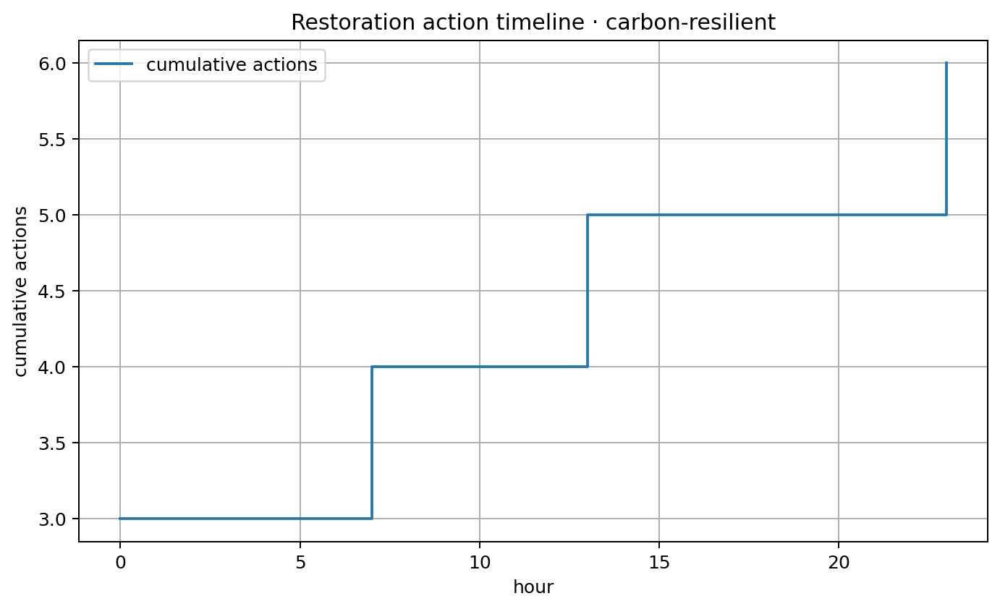

> 图展示累计动作数量；具体支路、动作类型和小时见 `artifacts/v08_official/flood/actions_carbon_resilient.csv`。

### 6.2 资源调度

[`dispatch.py`](src/gridrescue/dispatch.py) 用 CVXPY/CLARABEL 求解逐节点、逐组件、逐小时连续优化。主要变量包括：

- 医院/关键/普通负荷 served power；
- 上级电网购电；
- 光伏利用和弃光；
- BESS 充电、放电和 SOC；
- 柴油发电；
- 分组件 P/Q 支撑和服务上限。

概念目标函数：

```text
min  关键失供惩罚 + 普通失供惩罚
   + 柴油成本 + 上级电网成本
   + 碳排代价 + 储能吞吐代价 + 弃光代价
```

`ServiceContract` 可额外锁定医院、关键、普通 EENS 上限和 CareTask 逐时最低功率。非根孤岛只有在具备柴油/BESS 成网候选时才允许服务负荷，否则服务强制为 0 并记录原因。

### 6.3 P/Q 径向前推回代

[`powerflow.py`](src/gridrescue/powerflow.py) 使用平衡等值 P/Q、per-unit 径向 backward/forward sweep：

1. 从叶节点向根节点聚合 P/Q；
2. 从根节点向叶节点根据支路 R/X 更新复电压；
3. 计算支路功率、损耗、载流率和节点电压；
4. 迭代到电压和功率残差收敛；
5. 汇总每小时、节点、支路和孤岛组件证据。

任何低电压、热限超限、功率缺口、无 slack/GFM 或不收敛都会使 Physics gate 失败。

---

## 7. Care / Physics / MRV 三门原理

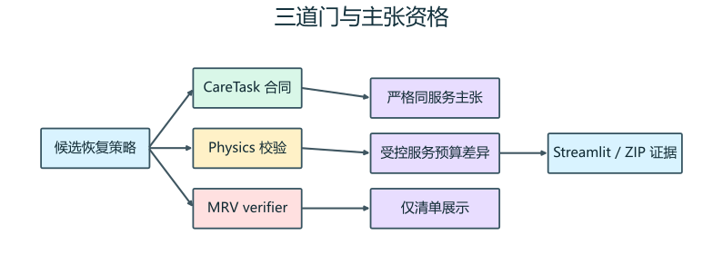

### 7.1 Care 门

**输入**：CareTask 定义、逐节点服务功率、逐节点电压、任务依赖。  
**检查**：最低功率、窗口、deadline、连续时长、依赖完成、电压范围。  
**输出**：任务级 PASS/FAIL、完成小时、最长连续服务、失败原因。

关键文件：

- 定义与算法：`src/gridrescue/care.py`；
- 单场景产物：`care_task_definitions.json`、`care_task_evaluation_*.csv`、`care_task_summary_*.json`；
- 测试：`tests/test_care.py`。

### 7.2 Physics 门

**输入**：每小时拓扑、节点负荷、资源调度、R/X、热限和工程约束。  
**检查**：径向性、P/Q 平衡、孤岛电源、节点电压、支路热限、损耗反馈、收敛。  
**输出**：`FlowValidation` 和 hourly/nodes/branches/components 四层表。

关键文件：

- 网络：`network.py`；
- 状态：`faults.py`、`restoration.py`；
- 潮流：`powerflow.py`；
- 反馈：`pipeline.py`；
- 孤岛护照：`islands.py`。

### 7.3 MRV 门

**输入**：冻结调度、动作、网络、场景、排放因子和 claim gates。  
**检查**：文件、记录、外键、方程、动作链和 seal。  
**输出**：`verified=true/false`、错误列表、checked files、可下载 ZIP。

清单纳入：

| 活动 | 计算方式 | 清单位置 |
|---|---|---|
| 上级电网购电 | `grid_kWh × grid_factor` | Scope 2 location-based |
| 柴油发电 | `diesel_kWh × diesel_factor` | Scope 1 |
| 抢修车辆 | `vehicle_km × vehicle_factor` | crew estimated |
| 网络损耗 | 逐时潮流损耗进入购电/资源平衡 | 对应 activity/inventory |

单列或排除：

- 新能源弃电作为机会损失单列；
- 开关/修复动作本身不直接乘排放因子；
- 居民停电和停产损失不折算为碳排；
- 设备制造隐含碳当前不纳入。

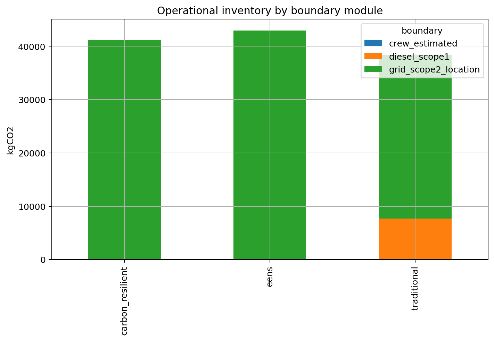

---

## 8. Pareto、批处理、风险与不确定性

### 8.1 词典序服务锚点与 ε 扫描

[`pareto.py`](src/gridrescue/pareto.py) 的实际顺序：

```text
医院服务损失最小 → 锁成硬上限
其他关键服务损失最小 → 锁成硬上限
普通服务损失最小 → 得到 0% 锚点
开放普通服务 ε 预算 → 最小化恢复阶段碳清单
每点重跑 Care + Physics → 仅合格点进入 frontier
```

失败点仍写入 `pareto_failures.csv` 和 manifest。

### 8.2 36 场景配对统计

[`experiments.py`](src/gridrescue/experiments.py) 对每条 scenario_id 运行三策略；[`paired_stats.py`](src/gridrescue/paired_stats.py) 只对同一场景的成功对计算差值，同时保留失败计数。统计包括：

- paired mean delta；
- 确定性 bootstrap 95% 区间；
- Wilson 成功率区间；
- failure manifest 精确重放。

### 8.3 尾部风险

[`risk.py`](src/gridrescue/risk.py) 同时报告均值、P95、CVaR95、失败率和 failure budget。默认 EENS 风险分数为均值与 CVaR 的组合，防止均值掩盖台风等尾部失败。

当前 36 场景 EENS 风险排序选择 `最小失供恢复`：

| 策略 | Mean EENS (kWh) | P95 | CVaR95 | 失败率 |
|---|---:|---:|---:|---:|
| 传统顺序恢复 | 12408.76 | 27713.45 | 29351.60 | 0% |
| 最小失供恢复 | 8698.34 | 26745.40 | 28161.05 | 0% |
| 碳韧协同恢复 | 11891.19 | 30121.08 | 31542.58 | 0% |

这说明碳韧策略不是所有目标下的默认赢家；系统会依据服务合同和风险口径决定是否推荐。

### 8.4 MRV 因子不确定性

[`mrv_sensitivity.py`](src/gridrescue/mrv_sensitivity.py) 固定 activity inventory，仅对 factor registry 的 `uncertainty_pct` 做 500 次 Latin Hypercube Sampling。

| 策略 ID | 基线 kgCO2 | Q05 | Q95 | 最低清单胜率 |
|---|---:|---:|---:|---:|
| `carbon_resilient` | 36655.39 | 30060.17 | 43242.57 | 0% |
| `eens` | 38104.46 | 31248.52 | 44952.05 | 0% |
| `traditional` | 34767.93 | 28513.04 | 41013.68 | 100% |

该敏感性只解释排放因子不确定性，不改变服务、物理或主张等级。

---

## 9. 当前实验结果怎么读

### 9.1 暴雨冻结场景三策略对比

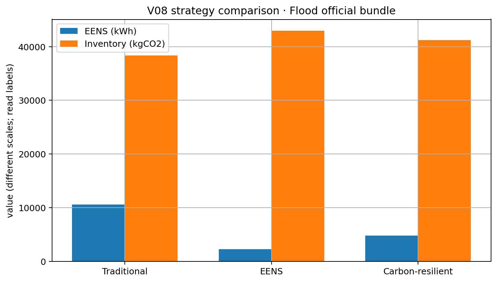

> 图中 EENS 使用 kWh，清单使用 kgCO2，两者量纲不同；应读取柱顶数字和原始 CSV，不按柱高直接比较跨指标大小。

### 9.2 36 场景配对结果：碳韧协同相对最小失供

| 指标 | 候选−参考配对均值 | 95% bootstrap 区间 | 解读 |
|---|---:|---:|---|
| EENS | +3192.85 kWh | [3046.78, 3324.06] | 普通服务让步导致总失供增加 |
| critical EENS | −15.05 kWh | [−22.74, −7.99] | 关键服务侧配对差更低 |
| 关键负荷恢复率 | +0.0466 个百分点 | [0.0247, 0.0704] | 关键服务略高 |
| 运行清单 | −2331.35 kgCO2 | [−2447.95, −2203.79] | 受控服务预算下的清单差异 |

正确结论：在固定 E 类合成压力集上，碳韧协同策略相对最小失供参考策略呈现**受控服务预算下**的运行碳清单差异，同时普通服务 EENS 增加。

### 9.3 strict-contract-9

```text
9 场景 × 2 个普通服务预算点 = 18 点
12 eligible
6 blocked
通过率 66.7%
暴雨 6/6
台风 0/6，normal_anchor 阶段阻断
高温 6/6
```

台风 6 个失败点保留在 points 和 manifest 中，没有填零、删除或移出分母。该实验是严格合同机制的代表性演示，不外推为 36 场景总体严格减排结论。

机器证据：[`artifacts/wave10/strict_contract_9/`](artifacts/wave10/strict_contract_9/)  
报告：[`docs/strict_contract_9_report.md`](docs/strict_contract_9_report.md)

---

## 10. 仓库目录逐块说明

```text
gridrescue/
├─ app.py                         # Streamlit 评委决策工作台
├─ src/gridrescue/                # 核心业务与算法源码
├─ scripts/                       # 批处理、图表、审计、打包和烟测脚本
├─ tests/                         # 73 项 pytest 回归测试
├─ data/                          # case33bw、排放因子、医院负荷与天气校准输入
├─ artifacts/                     # 运行结果、冻结证据、图表和历史实验
├─ docs/                          # 申报、答辩、事实、主张、图示和操作文档
├─ research_wave/                 # 多轮研究与方案迭代记录
├─ release/                       # 桌面正式提交 ZIP 与 SHA-256 校验文件
├─ pyproject.toml                 # 包、依赖和 pytest 配置
├─ requirements.txt               # 直接安装依赖
├─ release_manifest_*.json        # 发布文件及 SHA-256 清单
└─ README.md                      # 本文件
```

| 路径 | 有什么用 | 什么时候看 |
|---|---|---|
| `app.py` | 把 pipeline、冻结 cache、MRV、Pareto、Care、孤岛和图表组装为八页 UI | 演示、录屏、改界面 |
| `src/gridrescue/` | 核心求解、验证、统计和证据逻辑 | 开发、审计算法 |
| `scripts/` | 把核心 API 组合成批次、图表、报告、检查和 ZIP | 复现实验、发布 |
| `tests/` | 验证正常路径和失败路径，包括篡改、无源孤岛和失败分母 | 改代码后回归 |
| `data/` | case33bw、因子注册表、参数化医院生命线负荷、天气和停电聚合样本 | 核对网络、排放因子、医院负荷与外部事件来源 |
| `artifacts/` | 机器可读运行产物；正式证据和调试产物分区 | 评委复核、追溯结果 |
| `docs/` | 项目叙事、申报材料、事实源、主张字典、图片 | 写申报书、答辩、录视频 |
| `research_wave/` | 子代理研究和路线收敛过程 | 查看为什么采用当前方案 |
| `release/` | 最终交付镜像：提交 ZIP 与对应 SHA-256；该目录不参与 ZIP 内部打包 | 上传/发送正式材料前核对 |
| `release_manifest_*.json` | 发布版本的文件列表、字节数、SHA-256 和冻结口径 | 打包/提交前验收 |

---

## 11. 源码模块逐文件说明

所有业务代码位于 [`src/gridrescue/`](src/gridrescue/)。

| 文件 | 主要作用 | 核心接口/原理 | 主要输入与输出 |
|---|---|---|---|
| `case33_data.py` | 内置 case33bw 快照 | 固定 BASE_MVA/BASE_KV、节点负荷、37 条支路和源 SHA | 输出网络常量 |
| `network.py` | 构造网络和图状态 | `GridModel`、`build_ieee33()`、root component、islands、radial check | 输入 seed；输出 nodes/branches/graph |
| `scenarios.py` | 灾害定义和逐时环境 | `DisasterScenario`、24h 负荷/PV/grid carbon profile | 输入灾种/seed；输出场景与时序 |
| `scenario_catalog.py` | 36 场景冻结目录 | canonical payload + SHA-256 scenario_id | 输出 catalog CSV/manifest |
| `faults.py` | 故障和联络线状态 | 下游失供评分、贪心闭环、成环检查 | 输入 failed/ties；输出合法拓扑 |
| `restoration.py` | 修复计划和策略时序 | `make_plan()`、`state_at_hour()`、`simulate_strategy()` | 输出动作、需求、dispatch、report |
| `dispatch.py` | 资源和服务合同优化 | CVXPY/CLARABEL，PV/BESS/柴油/grid、SOC、EENS cap | 输入逐节点需求/合同；输出逐时调度 |
| `powerflow.py` | 径向 P/Q 潮流 | backward/forward sweep、电压、热限、损耗、组件检查 | 输出 hourly/nodes/branches/components |
| `pipeline.py` | 调度—潮流反馈总线 | 最大 8 次线损/服务上限反馈 | 输出三策略 `PipelineResult` |
| `care.py` | 生命线任务合同 | 时窗、deadline、连续时长、依赖、任务电压 | 输出任务级 PASS/FAIL |
| `islands.py` | 微网成岛能力护照 | episode、GFM/黑启动候选、P/Q/SOC/V/热限、薄弱约束 | 输出 hourly/episode passport |
| `metrics.py` | 恢复指标 | EENS、critical recovery、柴油、新能源、碳 | 输出 `RecoveryMetrics` |
| `carbon.py` | 碳清单计算 | grid/diesel/vehicle 分项和总量 | 输入 dispatch/factors；输出 breakdown |
| `real_event_mapping.py` | 区域停电统计映射 | OEDI 事件行、客户数代理比例、33 节点负荷权重 | 输出带边界标记的区域统计映射，不生成实测支路故障 |
| `mrv.py` | MRV 写入和独立验证 | canonical hash、record hash、action chain、seal、claim gate | 输出/验证 MRV bundle |
| `pareto.py` | 服务锚点和 ε 前沿 | 医院→关键→普通词典序，两阶段求解、非支配筛选 | 输出 anchors/points/frontier/failures |
| `experiments.py` | Monte Carlo 和失败重放 | 行级失败隔离、bootstrap、Wilson、manifest replay | 输出 results/summary/failure manifest |
| `paired_stats.py` | 同场景配对统计 | paired deltas、bootstrap mean、Wilson | 输出配对摘要 |
| `risk.py` | 尾部风险排名 | P95、CVaR95、failure budget、risk score | 输出风险卡和推荐策略 |
| `mrv_sensitivity.py` | 因子不确定性传播 | 确定性 Latin Hypercube Sampling | 输出 500 draws 和区间/胜率 |
| `report.py` | 单策略 Markdown 报告 | 场景、动作、指标和碳分项模板 | 输出 `report_*.md` |
| `facts.py` | 事实和主张文案检查 | 冻结 FACTS、禁止表述扫描 | 输出冲突片段 |
| `cli.py` | 单场景命令行入口 | 组合 pipeline、Care、护照、MRV、CSV/JSON 写出 | 输出完整 artifact 目录 |

### 11.1 核心调用关系

```text
cli.py / app.py / scripts
  └─ scenarios.py + network.py
       └─ restoration.py
            └─ dispatch.py
                 └─ pipeline.py ↔ powerflow.py
                      ├─ care.py
                      ├─ islands.py
                      ├─ metrics.py + carbon.py
                      ├─ pareto.py / experiments.py / risk.py
                      └─ mrv.py → verifier / UI / ZIP
```

---

## 12. 脚本、测试、文档和产物索引

### 12.1 `scripts/`

| 脚本 | 作用 | 主要输出 |
|---|---|---|
| `smoke_demo.py` | 启动 Streamlit、轮询 health、检查页面可访问 | smoke 状态和退出码 |
| `build_readme_visuals.py` | 使用微软雅黑并将中文转为 SVG 路径，重建架构图、三门图、页面导航和 case33bw 拓扑 | `docs/assets/readme/*.{png,svg}` |
| `build_figures.py` | 从冻结 V08/Wave10 证据重绘 7 张正式图 | `artifacts/wave10/figures/`、`docs/assets/readme/` |
| `run_wave10_batch.py` | 执行 36 场景 × 3 策略批处理 | `artifacts/wave10/batch36/` |
| `run_strict_contract_demo.py` | 运行严格 Care/Pareto 合同 Demo | `artifacts/wave10/strict_contract_demo/` |
| `build_c0_c4_gate.py` | 分离参考锚点和受控预算候选的主张资格 | `artifacts/wave10/c0_c4_gate/` |
| `build_paired_report.py` | 配对差、bootstrap 和 Wilson 报告 | paired CSV/JSON/Markdown |
| `build_risk_report.py` | 生成 P95/CVaR/failure budget | `artifacts/wave11/risk_report/` |
| `build_mrv_sensitivity.py` | 运行 500 次排放因子 LHS | `artifacts/wave11/mrv_sensitivity/` |
| `audit_claims.py` | 扫描材料是否违反 claim dictionary | 控制台结果/退出码 |
| `check_submission_ready.py` | 检查 ZIP、manifest、hash、smoke 和匿名提交结构 | readiness JSON |
| `build_submission.py` | 按白名单构建正式提交 ZIP 和 SHA-256；自动排除 `release/` 防止递归嵌套 | 上级 `outputs/`，再同步到 `release/` |

### 12.2 `tests/`

| 测试文件 | 覆盖重点 |
|---|---|
| `test_core.py` | case33bw、故障/联络线、三策略、潮流、无源孤岛硬失败 |
| `test_care.py` | CareTask 时窗、连续性、依赖、电压和非法定义 |
| `test_islands.py` | GFM/黑启动候选、episode、原因码和稳定 schema |
| `test_mrv.py` | 因子、活动、方程、动作 hash、缺失/篡改、claim gate |
| `test_pareto.py` | 锚点、ε 点、物理复核和失败点保留 |
| `test_experiments.py` | 行级失败隔离、置信区间、manifest 精确重放 |
| `test_paired_stats.py` | 配对差、失败计数、bootstrap/Wilson 确定性 |
| `test_risk.py` | 上尾 CVaR 和失败不归零 |
| `test_mrv_sensitivity.py` | LHS 可复现和策略行稳定 |
| `test_scenario_catalog.py` | 36 条 catalog、hash、determinism、重放 |
| `test_app_mrv.py` | UI live verifier、ZIP、场景错配和篡改可见 |
| `test_app_workbench.py` | 三门状态和 NO_GFM/BLOCKED 预设 |
| `test_facts.py` | 冻结事实和禁止主张 |

### 12.3 `docs/`

| 文档 | 用途 |
|---|---|
| `competition_factsheet.yaml` | 唯一结构化赛事事实源 |
| `claim_dictionary.md` | 允许/禁止主张和固定边界 |
| `competition_narrative.md` | 项目叙事、碳边界和评委质疑 |
| `contest_fit_2026.md` | 第五届双碳大赛赛道、匿名材料和适配 |
| `official_competition_facts_2026.md` | 已核对的赛事信息摘要 |
| `submission_application_v10.md` | 申报书母本 |
| `video_script_v10.md` | 五分钟视频脚本（4:55目标） |
| `judge_strategy.md` | 五分钟演示顺序与答辩策略 |
| `strict_contract_9_report.md` | 9 场景严格合同分层结果 |
| `strict_contract_demo.md` | 严格合同 Demo 说明 |
| `wave10_batch36_report.md` | 36 场景配对实验报告 |
| `final_submission_checklist.md` | 提交前逐项勾选 |
| `final_goal_audit.md` | 项目目标和发布就绪审计 |
| `team_recruitment_brief.md` | 组队分工和招募说明 |
| `10_day_execution_plan.md` | 十日执行计划 |
| `hospital_load_profile_sources.md` | 医院负荷 CSV 的公开规范/设备参考、参数化规则和 E 类边界 |
| `real_data_chain_research_2026.md` | 天气、停电、恢复时长公开数据源盘点和许可边界 |
| `real_event_mapping_method.md` | 区域停电统计到 case33bw 的映射公式和限制 |
| `evidence_index.csv` | 人工可读证据入口 |
| `assets/readme/` | README 使用的 SVG、PNG、Mermaid 和图源索引 |

`docs/agent_repo_inventory.md`、`docs/agent_readme_blueprint.md`、`docs/agent_visual_audit.md` 是本轮多子代理生成的内部审计底稿，方便后续维护 README。

### 12.4 `artifacts/`

| 分区 | 用途 | 是否正式证据 |
|---|---|---|
| `v08_official/{flood,typhoon,heat}` | 三灾种冻结运行结果和 MRV bundle | 是 |
| `wave10/catalog` | 36 条固定场景 catalog | 是 |
| `wave10/batch36` | 108 条策略结果、validation、paired delta、failure manifest | 是 |
| `wave10/c0_c4_gate` | strict/controlled/inventory-only 主张门分轨 | 是 |
| `wave10/strict_contract_9` | 9 场景严格合同批及 6 个失败点 | 是 |
| `wave10/strict_contract_demo` | 三灾种演示样本 | 演示证据 |
| `wave10/figures` | 七张正式图和 source index | 是 |
| `wave10/pipeline_cache` | Streamlit 离线预加载 cache | 演示用 |
| `wave11/risk_report` | P95/CVaR/failure budget | 是 |
| `wave11/mrv_sensitivity` | 500 次因子不确定性传播 | 是 |
| `flood_v0*`、`heat_v0*`、`typhoon_v0*` | 历史单场景开发结果 | 否，调试/迭代 |
| `mc30_v0*`、`pareto_*`、`debug_mrv` | 历史实验和测试 fixture | 否，调试/迭代 |

### 12.5 单场景产物怎么找

以 `artifacts/v08_official/flood/` 为例：

| 文件/目录 | 内容 |
|---|---|
| `network_nodes.csv`、`network_branches.csv` | 节点/支路及工程假设 |
| `network_manifest.json` | 网络来源 SHA 和基本参数 |
| `dispatch_*.csv` | 三策略逐时资源调度 |
| `actions_*.csv` | 修复和开关动作时间线 |
| `powerflow_*.csv` | 每小时物理摘要 |
| `powerflow_nodes_*.csv` | 节点电压、功率和服务证据 |
| `powerflow_branches_*.csv` | 支路潮流、损耗和载流率 |
| `powerflow_components_*.csv` | 分岛组件 P/Q 和可行性 |
| `care_task_*.csv/json` | 生命线任务定义、评估和摘要 |
| `island_passport_*.csv/json` | 非根孤岛护照和 episode |
| `report_*.md` | 人工可读策略报告 |
| `mrv/run-*/` | 完整 MRV 证据包 |

---

## 13. 快速开始

### 13.1 环境

- Windows PowerShell；
- Python `>=3.11`；
- 依赖：NumPy、pandas、NetworkX、CVXPY、Streamlit、Plotly、pytest。

### 13.2 安装

```powershell
cd <GridRescue项目目录>
py -3.11 -m venv .venv
.\.venv\Scripts\Activate.ps1
python -m pip install -U pip
python -m pip install -e ".[dev]"
```

也可以按 requirements 安装：

```powershell
python -m pip install -r requirements.txt
$env:PYTHONPATH="$PWD\src"
```

### 13.3 运行测试

```powershell
python -m pytest -q
```

2026-08-26 本地验收结果：

```text
62 passed
```

### 13.4 启动评委工作台

```powershell
$env:PYTHONPATH="$PWD\src"
streamlit run app.py
```

默认优先读取 `artifacts/wave10/pipeline_cache/`，用于离线、稳定演示。强制现场重算：

```powershell
$env:GRIDRESCUE_FORCE_LIVE="1"
streamlit run app.py
```

页面关系：

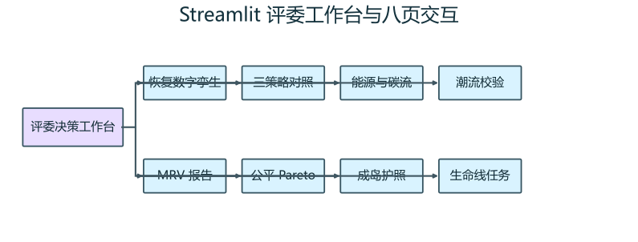

### 13.5 单场景全链运行

```powershell
$env:PYTHONPATH="$PWD\src"
python -m gridrescue.cli `
  --scenario "暴雨内涝" `
  --output artifacts/readme_flood `
  --created-at "2026-08-23T18:00:00+08:00"
```

该命令会输出网络、三策略调度、动作、潮流、Care、孤岛护照、报告和 MRV bundle。

### 13.6 验证 MRV

```powershell
python -m gridrescue.mrv verify artifacts/v08_official/flood/mrv/run-7e495c4e6e73c188
```

### 13.7 Pareto 扫描

```powershell
python -m gridrescue.pareto `
  --scenario "暴雨内涝" `
  --strategy "最小失供恢复" `
  --fractions "0,0.04,0.05,0.06" `
  --output artifacts/readme_pareto
```

### 13.8 批处理、风险和敏感性

```powershell
python -m gridrescue.experiments --count 30 --seed 20260822 --output artifacts/readme_mc30
python scripts/build_risk_report.py
python scripts/build_mrv_sensitivity.py
python scripts/build_figures.py
python scripts/build_readme_visuals.py
```

### 13.9 演示烟测

```powershell
python scripts/smoke_demo.py
```

---

## 14. 五分钟评委演示路线

### 0:00–0:40：先讲问题，不先讲算法

打开“评委决策工作台”，说明极端天气恢复同时面对服务、物理和碳证据约束。

### 0:40–1:30：展示三道门

选择“暴雨内涝 + 碳韧协同恢复”，展示：

- Care / 服务合同：PASS；
- Physics / 物理校验：PASS；
- MRV / 证据复算：PASS；
- 主张状态仍是受控服务预算差异。

### 1:30–2:20：展示故障恢复数字孪生

拖动 `恢复进程/小时`，查看故障支路、闭合联络线、节点恢复和动作时间线。强调每个时刻都对应真实拓扑状态。

### 2:20–3:10：展示 CareTask 和 Physics

打开 CareTask 页，展示任务窗口、连续供电、依赖和节点电压；再打开潮流页，展示最低电压、最大支路负载率和孤岛原因码。

### 3:10–4:00：展示 Pareto 和反例

打开受控服务 Pareto；说明普通服务预算是公开的。切换到 `NO_GFM · BLOCKED` 预设，展示系统会阻断物理不可行候选，而不是输出一个看似更低的碳数字。

### 4:00–4:20：现场验证 MRV

点击 MRV 复核和 ZIP 下载，展示 activity、factor、inventory、reconciliation、seal 和 verifier。

### 4:20–4:55：收束

结论只说：GridRescue 提供了一个服务合同门控、物理可行、证据可复算的配电网低碳恢复预案平台；当前数据为合成工程输入，下一步接入真实馈线、天气回放和权威排放因子。

详细台词：[`docs/video_script_v10.md`](docs/video_script_v10.md)  
答辩策略：[`docs/judge_strategy.md`](docs/judge_strategy.md)

---

## 15. MRV 证据包结构与验证

```text
mrv/run-<run_id>/
├─ run_manifest.json
├─ inputs/
│  ├─ config.json
│  ├─ factor_registry.csv
│  ├─ factor_snapshot.csv
│  ├─ network_snapshot.json
│  └─ scenario.json
├─ outputs/
│  ├─ activity_energy_hourly.csv
│  ├─ emission_inventory_hourly.csv
│  ├─ carbon_reconciliation.csv
│  ├─ dispatch_*.csv
│  ├─ topology_state_*.csv
│  └─ claim_gates.json
└─ evidence/
   ├─ evidence_index.json
   ├─ seal.json
   └─ verification.json
```

### 15.1 完整性机制

- 每个文件写入 SHA-256；
- CSV 记录带语义归一化 `record_hash`；
- 动作记录形成前向 hash 链；
- manifest 绑定场景、网络、代码包、因子和输出；
- seal 绑定最终证据索引；
- verifier 独立读取文件并重新计算。

### 15.2 篡改时会怎样

修改 activity、factor、inventory、action 或 evidence index 后，verifier 会返回 `verified=false` 和错误列表；Streamlit 会将 MRV 门显示为 `BLOCKED`，不会静默沿用旧的 PASS。

### 15.3 图源追溯

README 中七张 Wave10 正式图的输入文件、run_id、冻结日期和 SHA-256 位于：

[`docs/assets/readme/figure_source_index.csv`](docs/assets/readme/figure_source_index.csv)

---

## 16. 主张边界、局限与下一步

### 16.1 当前允许的表述

> 在 E 类合成压力场景、固定 Care 合同、当前物理模型和公开普通服务预算下，GridRescue 能生成并复算三种恢复策略的服务、物理和运行碳清单证据；碳韧协同策略展示的是受控服务预算下的清单差异。

### 16.2 当前边界

| 当前边界 | 影响 | 已有控制 | 下一步 |
|---|---|---|---|
| 使用 case33bw 公开算例 | 外部效度有限 | 固定 SHA、全量节点/支路导出 | 接入真实馈线模型 |
| DER 位置、关键等级、热限为工程假设 | 不代表现场配置 | manifest/factsheet 标注 E 类 | 建立现场数据审批和来源 hash |
| 修复和联络线选择为启发式 | 不保证全局最优 | 三策略同场景对比、失败保留 | 统一含整数开关的 MISOCP |
| DER 无功能力为工程近似 | 设备级能力不完整 | 显式 P/Q 容量和物理门 | 逐设备 `P²+Q²≤S²` |
| 场景为确定性合成压力集 | 不代表真实概率 | 固定 catalog 和重放 manifest | 接入武汉 ERA5/Open-Meteo 回放 |
| 因子为 E 类 engineering prior | 不代表权威实测 | 版本注册、hash、500 次 LHS | 接入公开/实测因子和审批记录 |
| 固定 1 小时时步长 | SOC、EENS 和任务精度受限 | verifier 强制 `time_step_h=1.0` | 15/30 分钟端到端改造 |
| Streamlit 为离线预案工作台 | 不是实时 SCADA/OMS 控制 | cache、replay、人工审批 | 建立受控接口和权限审计 |

### 16.3 三个固定语义

- `SEALED`：文件完整性封存；
- `Verification=PASS`：内部引用和复算方程通过；
- `same_service_pass=false`：当前主结果不是严格同服务比较。

---

## 17. 比赛提交材料索引

| 材料 | 路径 | 用途 |
|---|---|---|
| 申报书母本 | [`docs/submission_application_v10.md`](docs/submission_application_v10.md) | 填写正式申报书 |
| 五分钟视频脚本（4:55目标） | [`docs/video_script_v10.md`](docs/video_script_v10.md) | 录制项目视频 |
| 评委策略 | [`docs/judge_strategy.md`](docs/judge_strategy.md) | 演示顺序和答辩 |
| 赛事适配 | [`docs/contest_fit_2026.md`](docs/contest_fit_2026.md) | 赛道、匿名和材料检查 |
| 主张字典 | [`docs/claim_dictionary.md`](docs/claim_dictionary.md) | 统一所有材料口径 |
| 事实源 | [`docs/competition_factsheet.yaml`](docs/competition_factsheet.yaml) | 统一数字、日期和边界 |
| 36 场景报告 | [`docs/wave10_batch36_report.md`](docs/wave10_batch36_report.md) | 配对统计和主张说明 |
| 严格合同报告 | [`docs/strict_contract_9_report.md`](docs/strict_contract_9_report.md) | 展示通过和失败分母 |
| 十日计划 | [`docs/10_day_execution_plan.md`](docs/10_day_execution_plan.md) | 团队执行安排 |
| 组队简报 | [`docs/team_recruitment_brief.md`](docs/team_recruitment_brief.md) | 分工招募 |
| 提交清单 | [`docs/final_submission_checklist.md`](docs/final_submission_checklist.md) | 正式上传前检查 |
| 发布 manifest | [`release_manifest_wave11_submission.json`](release_manifest_wave11_submission.json) | 文件 hash 与版本索引 |

构建正式提交包：

```powershell
python scripts/build_submission.py
python scripts/check_submission_ready.py --run-smoke
```

提交前应额外检查：文件名、PDF metadata、图片 EXIF、视频片头片尾、Git remote、绝对路径、用户名、学校/学院/导师信息和 ZIP 内单一 manifest。

---

## 18. 单人主导执行与技术审计

当前没有固定队友时，先看：[`docs/solo_operator_plan.md`](docs/solo_operator_plan.md)。它把工作拆成项目负责人、实验复核队员和演示队员三个最低角色；两名队员只需完成一次真实复核/彩排和报名确认，不需要重写核心代码。

技术闭环复核记录见：[`docs/technical_audit_wave11.md`](docs/technical_audit_wave11.md)。截至 2026-08-27，聚焦技术测试为 `44 passed`，全量回归为 `73 passed`。本轮新增官方电力因子、参数化医院负荷、武汉真实天气校准样本和区域停电统计映射；下一轮重点是事件级故障映射和答辩节奏，而不是继续扩张算法。

---

## 19. README 与项目验收记录

本 README 于 **2026-08-26** 由主代理统一验收，信息来源包括源码、62 项测试、冻结 artifact、manifest、三份审计底稿和本地 Streamlit 截图。

建议每次模型、因子、场景或结果变化后按以下顺序更新：

```text
competition_factsheet.yaml
→ claim_dictionary / evidence_index
→ 运行 artifact 与 figures
→ README / 申报书 / 视频脚本
→ pytest / MRV verifier / submission ready
→ manifest / ZIP / SHA-256
```

**一句话收束：GridRescue 不只计算碳排，而是规定这个数字在什么服务、物理和证据条件下才有资格被相信。**


## Real event replay (event_001)

The repository now includes one reproducible public-data replay: OEDI/EAGLE-I Texas-1 severe-weather outage in Harris County (2021-02-16 peak interval) joined with Houston hourly historical weather. The case is executed through the existing 33-node pipeline and writes node mapping plus three-strategy comparison artifacts.

- Code: `src/gridrescue/real_event_replay.py`
- One-command replay: `python scripts/real_event_replay.py --event-id Texas-1 --county Harris --year 2021`
- Case data and outputs: data/events/event_001/
- Method and claim boundary: docs/real_event_replay_event001.md
- Direct ZIP reader: load_oedi_event_correlated_from_zip(...) in src/gridrescue/real_event_mapping.py

The replay labels the translation `E_external_aggregate` / `regional_statistical_mapping`; it is not Wuhan feeder telemetry or a field accident reconstruction.

## Code organization quick guide

For a readable entry point, start with `src/gridrescue/api.py` instead of importing many implementation modules individually. It exposes `build_model()`, `run_named_scenario()`, and `replay_public_event(...)` while preserving all historical module paths.

- Module responsibility map: `docs/code_organization.md`
- Script command index: `scripts/README.md`
- Public event inputs and outputs: `data/events/`
