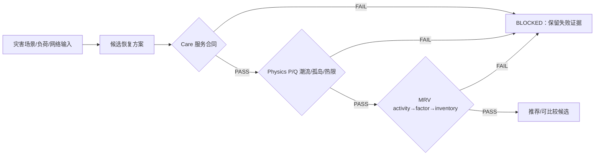
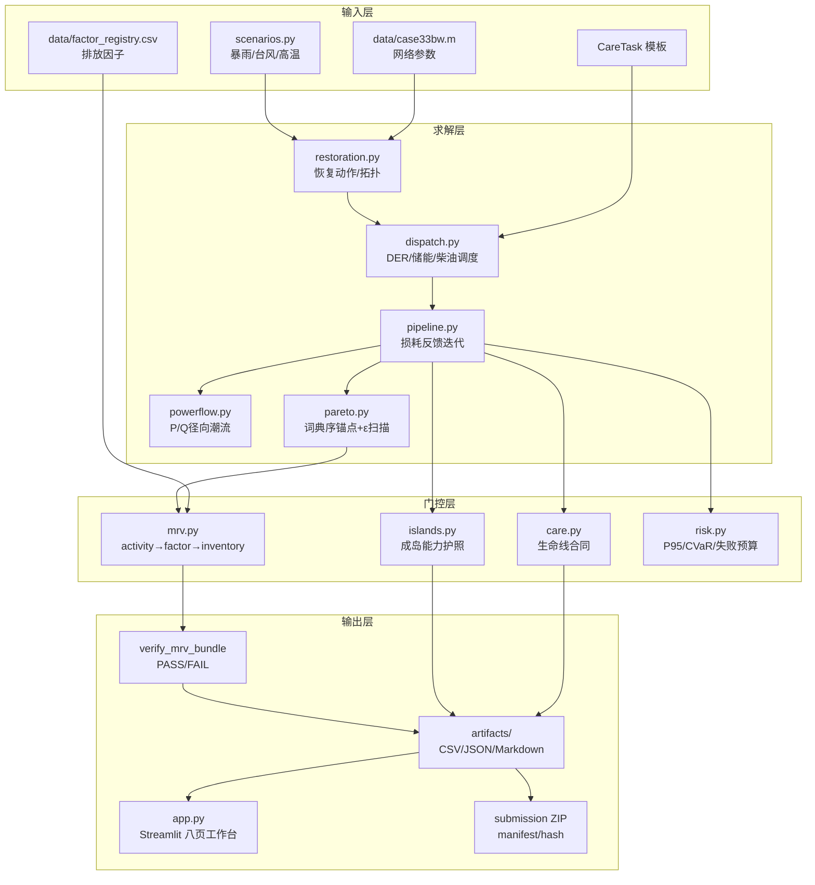

# GridRescue README 信息架构蓝图（供主 README 重写）

> **用途**：本文件不是最终 README，而是给主 agent/队员/开发者使用的编写蓝图。它把现有仓库、算法、证据和竞赛材料组织成一个可直接落地的 README 目录，并明确每一块应写什么、对应哪个文件、原理如何解释、图片放在哪里、评委如何演示。
>
> **目标读者**：
> 1. 评委：5 分钟内理解问题、创新、证据和边界；
> 2. 队员：知道如何运行、录屏、复现和准备提交材料；
> 3. 开发者：知道每个模块的职责、输入输出、测试和扩展点。

---

## 0. README 编写原则

### 0.1 首屏原则

首屏只回答四件事：

- **解决什么问题**：极端天气下配电网故障恢复与低碳保供的冲突；
- **怎么解决**：Care（服务合同）→ Physics（P/Q 潮流与孤岛）→ MRV（可复算证据）三道门；
- **凭什么相信**：同一场景配对、失败分母保留、MRV verifier、冻结 bundle；
- **现在能做到什么**：面向合成工程输入的预案级数字孪生原型，不冒充现场实测或实时 SCADA 控制。

推荐首屏一句话：

> **GridRescue 是一个“服务合同门控、证据承载”的低碳韧性配电网恢复数字孪生：候选方案只有同时通过生命线服务、配电网物理和 MRV 证据三门，才进入推荐。**

### 0.2 事实口径原则

所有数字、单位、状态必须以以下冻结源为准，不在 README 手写第二套口径：

- `docs/competition_factsheet.yaml`：结构化事实源；
- `docs/claim_dictionary.md`：允许/禁止主张；
- `docs/evidence_index.csv`：证据索引；
- `release_manifest_wave11_submission.json`：提交包文件与 hash；
- `artifacts/wave10/figures/figure_source_index.csv`：图源、run_id、SHA 与冻结日期。

如果测试数字变化，先改 factsheet，再同步 README、申报书、视频和图表。

### 0.3 “结果”与“边界”必须同屏

任何展示“碳排降低”时，旁边必须同时写：

```text
same_service_pass=false
claim_status=controlled_service_budget_inventory_difference
```

并说明：当前数据为 E 类合成工程假设，`SEALED` 只表示文件完整性与内部复算，不表示现场实测或第三方核证。

---

# 一、推荐 README 目录（最终顺序）

## 1. 项目标题、徽章和一页摘要

### 应写内容

- 标题：`碳韧智网 GridRescue`；
- 副标题：`极端天气配电网故障恢复 · 低碳保供 · 可解释数字孪生`；
- 竞赛定位：第五届中国研究生“双碳”创新与创意大赛，建议主投赛道二/赛题 2.1；
- 状态徽章：Python 3.11、pytest、Streamlit、MRV verifier；
- 一段 120–180 字摘要；
- 关键事实卡片：33 节点、3 灾种、3 策略、36 冻结场景、3 个 V08 MRV bundle、全量测试 62 passed（V08 基线 46 passed）。

### 对应文件

- 根目录 `README.md`（最终写入位置）；
- `pyproject.toml`（版本与依赖）；
- `docs/competition_factsheet.yaml`（事实）；
- `docs/submission_application_v10.md`（摘要母本）。

### 图片

仓库已准备好可直接嵌入 README 的素材目录：`docs/assets/readme/`。优先使用该目录中的 SVG/PNG，不要重新引用临时路径。

首屏建议一张“系统三门漏斗”图：

```markdown

```

如果该图只展示 Physics，需在 README 旁用 Mermaid 补全三门：



---

## 2. 项目定位：现实问题、目标和非目标

### 2.1 现实问题

说明暴雨内涝、台风、极端高温造成：

- 多支路故障与联络开关重构；
- 关键负荷（医院、通信、冷链等）有时限和连续供电要求；
- 柴油、储能、光伏、上级电网和抢修资源相互竞争；
- “少供电所以碳排少”的伪低碳结论风险。

### 2.2 项目目标

- 在同一场景、同一资源和同一 Care 合同下比较恢复策略；
- 将恢复顺序、拓扑、调度和碳清单放入一个可复算链；
- 对不可行孤岛、普通服务让步和 MRV 篡改显式阻断；
- 输出评委可读、开发者可复现的证据包。

### 2.3 非目标（必须明确）

- 不是实时 SCADA/OMS 自动控制器；
- 不是现场测量、临床运行标准或第三方核证系统；
- 不是严格同服务减排证明（当前 `same_service_pass=false`）；
- 不是完整 MISOCP、AC-OPF、GNN/RL 生产系统；
- 36 个合成压力场景不是实际灾害概率样本。

### 对应文件

- `docs/competition_narrative.md`：问题叙事、碳边界和评委质疑；
- `docs/claim_dictionary.md`：允许/禁止写法；
- `docs/contest_fit_2026.md`、`docs/official_competition_facts_2026.md`：赛事定位与材料约束。

### 图片

建议加入问题→方法→证据三列图，图中文字从上述文档抽取，避免自创事实。

---

## 3. 核心创新点（评委先看）

README 不要只列“用了哪些算法”，要说明每个创新阻断了哪一种误判。

### 创新一：CareTask 服务合同门

- 每个任务包含节点、最小功率、时窗、deadline、连续时长、依赖和最低电压；
- 医院/关键服务先求锚点，再允许普通负荷在公开 ε 预算内让步；
- 任务失败保留 `failure_reason_codes`，不把缺失值填 0。

**代码位置**：`src/gridrescue/care.py`；调用方：`pipeline.py`、`pareto.py`、`app.py`；测试：`tests/test_care.py`。

### 创新二：Physics 物理可行性门

- 33 节点/32 常闭支路/5 常开联络线；
- 成岛、径向性、P/Q 平衡、节点电压、支路热限和损耗反馈；
- 无成网型电源或资源越限的孤岛直接 `BLOCKED/NO_GFM`；不注入虚拟 slack 掩盖缺口。

**代码位置**：`network.py`、`faults.py`、`restoration.py`、`dispatch.py`、`powerflow.py`、`pipeline.py`；测试：`test_core.py`、`test_islands.py`、`test_app_workbench.py`。

### 创新三：MRV 证据门

- 逐时 activity ledger、factor snapshot、inventory、carbon reconciliation、action chain、manifest、evidence index、seal；
- 文件 SHA-256 + 行级 semantic hash + 跨表外键 + 方程复算；
- 修改活动账、因子或动作链后 verifier 必须 FAIL。

**代码位置**：`src/gridrescue/mrv.py`；工具：`python -m gridrescue.mrv verify ...`；测试：`tests/test_mrv.py`、`tests/test_app_mrv.py`。

### 创新四：受控服务差异，而不是伪减排

- 参考策略：`最小失供恢复`；候选：`碳韧协同恢复`；
- 关键服务硬锁，普通服务预算显式化；
- 当前只支持 `controlled_service_budget_inventory_difference`。

**代码位置**：`src/gridrescue/pareto.py`、`metrics.py`、`app.py`；证据：`artifacts/wave10/c0_c4_gate/`、`docs/strict_contract_9_report.md`。

### 创新五：失败可见、可重放

- Monte Carlo 每条场景/策略都保留 `scenario_id`、seed、payload SHA、失败阶段和原因；
- 台风严格合同失败不被剔除，作为反例展示；
- Wave10 catalog 固定为 3 灾种 × 3 强度 × 4 复本 = 36 场景。

**代码位置**：`experiments.py`、`scenario_catalog.py`、`paired_stats.py`；证据：`artifacts/wave10/batch36/`、`artifacts/wave10/strict_contract_9/`。

---

## 4. 系统架构与端到端数据流

### 4.1 架构图（README 必放）



### 4.2 数据流解释

1. `network.build_ieee33()` 读取/构造 IEEE/MATPOWER case33bw 衍生网络；
2. `scenarios.py` 生成灾种、故障支路、修复小时、PV derating、碳因子倍率、抢修距离和温度；
3. `restoration.simulate_strategy()` 生成三种策略动作序列和逐时负荷；
4. `dispatch.dispatch_resources*()` 分配上级电网、PV、BESS、柴油机；
5. `powerflow.validate_dispatch()` 对每个小时执行 P/Q 潮流、支路/节点/孤岛校验；
6. `pipeline._simulate_with_loss_feedback()` 将潮流损耗与组件服务上限反馈回调度，迭代至收敛或记录失败；
7. `care.evaluate_care_tasks()` 检查生命线任务；`islands.build_island_passports()` 生成孤岛护照；
8. `mrv.write_mrv_bundle()` 写出活动、因子、清单和 hash 证据；`verify_mrv_bundle()` 独立复核；
9. `app.py` 优先加载冻结 cache/MRV，现场探索与正式证据分离。

---

## 5. 算法原理（开发者与答辩技术问题）

### 5.1 恢复策略

| 策略 | 实现 | 目标 | README 解释重点 |
|---|---|---|---|
| 传统顺序恢复 | `restoration.py` | 固定优先级/人工规则 | 经验基线 |
| 最小失供恢复 | `restoration.py` + `dispatch.py` | 最小 EENS/加权失供 | 韧性参考锚点 |
| 碳韧协同恢复 | `restoration.py` + `dispatch.py` + `pipeline.py` | 服务约束下平衡 EENS、时间和恢复阶段碳排 | 核心候选 |

### 5.2 服务合同与词典序锚点

`pareto.py` 的逻辑应以伪代码写清：

```text
先求医院服务损失最小值 → 锁定为硬上限
再求其他关键服务损失最小值 → 锁定为硬上限
再求普通服务损失最小值 → 得到 0% 服务锚点
在锚点基础上允许普通负荷 ε=0/4/5/6% 让步
每个 ε 点重新做 dispatch → P/Q 潮流 → Care/Physics 复核
仅通过点进入 frontier；失败点写入 pareto_failures.csv
```

### 5.3 物理潮流与反馈

- 使用平衡 P/Q 径向前推回代；
- 节点负荷、支路 R/X、支路热限额和电压下限显式参与；
- `pipeline.py` 最多 8 次反馈迭代，默认残差容差 0.10 kW；
- 支路过载或低压时缩放组件可服务容量，再重求 dispatch；
- `FlowValidation.hourly.is_feasible` 是 Physics gate 的主字段。

### 5.4 碳清单与 MRV

纳入主清单：

- 上级电网购电（`grid_import`）；
- 柴油发电（`diesel_generation`）；
- 抢修车辆/移动电源运输（`crew_vehicle`）。

单列但不混入主清单：新能源弃电机会损失。恢复供电量不直接等价于减排量。

MRV 方程示意：

```text
energy_kwh = power_kw × time_step_h
emission_kgCO2 = activity_kwh × factor_value
inventory_total = Σ emission_kgCO2
```

当前固定 `time_step_h=1.0`，气体边界 `CO2`，单位 `kgCO2`，因子等级 `E / engineering_prior / conditional`。

### 5.5 风险与不确定性

- `risk.py`：均值、P95、CVaR95、失败率、failure budget；
- `mrv_sensitivity.py`：固定 activity inventory，仅对 factor registry 的 uncertainty_pct 做 500 次确定性 LHS；
- 风险排序不会改变 Care/Physics gate，也不会把主张升级为严格同服务减排。

---

## 6. 仓库目录逐项说明（必须完整）

README 建议提供下表，避免“只写 src，不解释 artifacts/docs”。

### 6.1 根目录

| 路径 | 用途 | 何时查看 |
|---|---|---|
| `app.py` | Streamlit 入口、评委工作台和八个交互页 | 启动演示、改 UI |
| `pyproject.toml` | 包元数据、Python 版本、依赖、pytest 配置 | 安装、打包、CI |
| `requirements.txt` | 运行时依赖快照 | 无 editable install 时安装 |
| `README.md` | 面向用户/评委/开发者总文档 | 首次阅读 |
| `release_manifest_*.json` | 发布包文件、hash、版本证据 | 提交前审计 |
| `outputs/`（若存在） | 生成的 ZIP、SHA256、提交产物 | 上传比赛材料 |

### 6.2 `src/gridrescue/` 模块表

| 文件 | 职责 | 关键接口/对象 |
|---|---|---|
| `network.py` | 构造 IEEE 33 节点模型、图结构、根分量、孤岛、径向性 | `GridModel`, `build_ieee33`, `graph_from_state`, `is_radial` |
| `case33_data.py` | case33bw 节点/支路原始数据与转换 | 网络数据常量/转换函数 |
| `scenarios.py` | 三灾种定义、逐时 profile、随机故障场景 | `DisasterScenario`, `SCENARIOS`, `sample_fault_scenarios` |
| `scenario_catalog.py` | 固定 root seed 的可重放场景目录、payload hash | `build_catalog`, `write_catalog` |
| `faults.py` | 故障状态、下游评分、联络线贪心闭合 | `FaultState`, `evaluate_state`, `close_ties_greedily` |
| `restoration.py` | 恢复计划、动作时间线、策略模拟、状态快照 | `RestorationPlan`, `simulate_strategy`, `state_at_hour` |
| `dispatch.py` | PV/BESS/柴油/上级电网资源配置与服务合同 | `ResourceConfig`, `ServiceContract`, `dispatch_resources` |
| `powerflow.py` | P/Q 径向前推回代、节点电压、支路热限、小时可行性 | `FlowValidation`, `validate_dispatch` |
| `pipeline.py` | 调度↔潮流损耗/容量反馈闭环 | `PipelineResult`, `run_pipeline`, `solve_strategy_with_feedback` |
| `care.py` | CareTask 定义、连续时长/deadline/电压证据 | `CareTask`, `evaluate_care_tasks` |
| `islands.py` | 非根孤岛 episode、GFM/黑启动/储能/热限护照 | `IslandPassportResult`, `build_island_passports` |
| `metrics.py` | EENS、关键恢复率、柴油、新能源、碳等汇总 | `RecoveryMetrics`, `calculate_metrics` |
| `carbon.py` | 排放因子和活动量到排放量换算 | `EmissionFactors`, `calculate_carbon` |
| `mrv.py` | MRV bundle 写入、hash 链、claim gates、独立 verifier | `write_mrv_bundle`, `verify_mrv_bundle` |
| `pareto.py` | 词典序服务锚点、ε 扫描、非支配前沿、失败表 | `ParetoScanSpec`, `scan_pareto` |
| `experiments.py` | Monte Carlo 批处理、失败隔离、Wilson/bootstrap 区间、重放 | `run_monte_carlo`, `build_failure_manifest` |
| `paired_stats.py` | 同 scenario_id 策略配对差值、bootstrap/Wilson | `paired_deltas`, `summarize_pairs` |
| `risk.py` | P95/CVaR95/failure budget 策略选择 | `RiskSummary`, `summarize_risk`, `choose_strategy` |
| `mrv_sensitivity.py` | 因子不确定性 LHS 传播、区间和胜率 | `propagate_factor_uncertainty` |
| `report.py` | Markdown 运行报告模板 | `markdown_report` |
| `facts.py` | 竞赛事实源加载、文案一致性检查 | `FACTS`, `validate_text` |
| `cli.py` | 单场景 CLI，写网络、策略、潮流、护照、Care、MRV 全套 artifact | `main` |

### 6.3 `scripts/` 工具表

| 脚本 | 用途 | README 命令 |
|---|---|---|
| `smoke_demo.py` | 启动 Streamlit 并检查 `/_stcore/health` | `python scripts/smoke_demo.py` |
| `build_figures.py` | 从正式 artifact 重绘 Wave10 七张图 | `python scripts/build_figures.py` |
| `run_wave10_batch.py` | 36 场景批处理、配对统计、失败 manifest | `python scripts/run_wave10_batch.py` |
| `run_strict_contract_demo.py` | 3 场景严格 Care/Pareto Demo | `python scripts/run_strict_contract_demo.py` |
| `build_c0_c4_gate.py` | C0/C4 服务与主张门分轨 | `python scripts/build_c0_c4_gate.py` |
| `build_paired_report.py` | 生成 paired delta 报告 | `python scripts/build_paired_report.py` |
| `build_risk_report.py` | 生成 CVaR95/失败预算报告 | `python scripts/build_risk_report.py` |
| `build_mrv_sensitivity.py` | 500 次因子不确定性传播 | `python scripts/build_mrv_sensitivity.py` |
| `audit_claims.py` | 检查材料中的主张是否违反 claim dictionary | `python scripts/audit_claims.py` |
| `check_submission_ready.py` | 提交包、hash、testzip、匿名材料就绪检查 | `python scripts/check_submission_ready.py` |
| `build_submission.py` | 生成最终提交 ZIP | `python scripts/build_submission.py` |

### 6.4 `data/`

- `data/case33bw.m`：公开 MATPOWER case33bw 网络源文件；README 要标注来源、SHA-256、33 节点/32 常闭/5 常开；
- `data/factor_registry.csv`：版本化排放因子注册表；当前 E 类合成工程假设；
- 不要把 `data/` 里的合成输入写成现场数据。

### 6.5 `tests/`

按主题说明：

- `test_core.py`：网络、恢复、潮流核心；
- `test_care.py`：CareTask 时窗/连续性/电压；
- `test_islands.py`：成岛护照和 BLOCKED 原因；
- `test_mrv.py`、`test_app_mrv.py`：证据包、hash、verifier、UI 复核；
- `test_pareto.py`：锚点、ε 点、失败保留；
- `test_experiments.py`、`test_paired_stats.py`：批处理、配对统计和失败分母；
- `test_risk.py`、`test_mrv_sensitivity.py`：尾部风险和不确定性；
- `test_app_workbench.py`：评委工作台状态。

### 6.6 `docs/`

README 应提供导航，不重复全文：

| 文档 | 用途 |
|---|---|
| `competition_factsheet.yaml` | 唯一结构化赛事事实源 |
| `claim_dictionary.md` | 主张允许/禁止表述 |
| `competition_narrative.md` | 项目叙事、碳边界、质疑回答 |
| `contest_fit_2026.md` | 第五届双碳大赛赛道与匿名材料适配 |
| `judge_strategy.md` | 五分钟演示与问答策略 |
| `submission_application_v10.md` | 申报书 V10 母本 |
| `strict_contract_9_report.md` | 严格合同 9 场景结果与失败分母 |
| `strict_contract_demo.md` | 3 场景 C0/C4 严格 Demo |
| `final_submission_checklist.md` | 发布前工程/材料/现场清单 |
| `evidence_index.csv` | 证据文件索引 |
| `final_goal_audit.md` | 目标与交付审计 |
| `scope_log.md` | 范围和变更记录 |
| `video_script_v10.md` | 五分钟视频脚本（4:55目标） |

### 6.7 `artifacts/`

README 要按“可运行输出/冻结证据/历史调试”分层解释：

- `artifacts/v08_official/{flood,typhoon,heat}`：V08 三个正式冻结 MRV bundle；
- `artifacts/wave10/catalog`：36 条可重放场景 catalog；
- `artifacts/wave10/batch36`：36 场景物理批处理、paired deltas、failure manifest；
- `artifacts/wave10/c0_c4_gate`：C0/C4 主张门分轨；
- `artifacts/wave10/strict_contract_9`：9 场景严格合同批；
- `artifacts/wave10/strict_contract_demo`：3 场景严格合同演示；
- `artifacts/wave10/figures`：七张正式图及 `figure_source_index.csv`；
- `artifacts/wave10/pipeline_cache`：评委现场离线预加载 pickle；删除或设置 `GRIDRESCUE_FORCE_LIVE=1` 才现场重算；
- `artifacts/wave11/risk_report`：CVaR/失败预算 JSON/CSV；
- `artifacts/wave11/mrv_sensitivity`：500 次因子不确定性传播；
- `artifacts/debug_mrv`、`flood_v0*`、`mc30_v0*`、`pareto_*`：开发调试/历史版本，README 标为非正式证据，避免评委误读。

---

## 7. 快速开始（按使用者分层）

### 7.1 开发者安装

```powershell
cd <GridRescue项目目录>
py -3.11 -m venv .venv
.\.venv\Scripts\Activate.ps1
python -m pip install -U pip
python -m pip install -e ".[dev]"
```

若只使用 requirements：

```powershell
python -m pip install -r requirements.txt
$env:PYTHONPATH="$PWD\src"
```

### 7.2 最小验证

```powershell
python -m pytest -q
python scripts/smoke_demo.py
```

README 应解释：当前开发树全量回归为 **62 passed**；V08 正式发布事实源中的基线为 **46 passed**，两者是不同冻结口径，不要混写。

### 7.3 单场景生成完整证据

```powershell
$env:PYTHONPATH="$PWD\src"
python -m gridrescue.cli --scenario "暴雨内涝" --output artifacts/flood --created-at "2026-08-22T18:00:00+08:00"
python -m gridrescue.mrv verify artifacts/flood/mrv/run-7e495c4e6e73c188
```

输出包括：网络节点/支路、三策略 dispatch/actions、潮流节点/支路/组件、岛护照、CareTask CSV、Markdown 报告和 MRV bundle。

### 7.4 Pareto 与批处理

```powershell
python -m gridrescue.pareto --scenario "暴雨内涝" --strategy "最小失供恢复" --fractions "0,0.04,0.05,0.06" --output artifacts/pareto_flood
python -m gridrescue.experiments --count 30 --seed 20260822 --output artifacts/mc30
python -c "from gridrescue.scenario_catalog import write_catalog; write_catalog('artifacts/wave10/catalog')"
```

### 7.5 启动交互界面

```powershell
streamlit run app.py
# 评委/录屏稳定模式
streamlit run app.py --server.headless true --server.fileWatcherType none
```

现场需要强制实时重算时：

```powershell
$env:GRIDRESCUE_FORCE_LIVE="1"
```

---

## 8. 五分钟评委演示路径（README 必须有）

### 0:00–0:30 首屏定位

- 选择“暴雨内涝”；
- 指向“评委决策工作台”；
- 说清三门和当前主张状态。

### 0:30–1:20 恢复数字孪生

- 在“恢复数字孪生”页拖动 `T+0h`→`T+4h`→`T+23h`；
- 解释故障支路、联络线闭合、节点供电颜色和动作时间线；
- 对应图：`wave10_04_action_timeline.png`。

### 1:20–2:00 三策略对照/能源流

- 切换“传统顺序恢复”“最小失供恢复”“碳韧协同恢复”；
- 只讲可复算指标：EENS、关键 EENS、柴油、可再生消纳、运行清单；
- 对应图：`wave10_01_strategy_comparison.png`、`wave10_02_inventory_breakdown.png`。

### 2:00–2:40 物理与 NO_GFM 反例

- 打开“潮流校验”；展示最低电压、最大负载率、不可行小时；
- 在工作台证据预设选择“NO_GFM 反例 · BLOCKED”；
- 强调失败被保留，没有用虚拟 slack 或 0 值掩盖；
- 对应图：`wave10_03_physics_voltage_gate.png`。

### 2:40–3:20 CareTask 与公平 Pareto

- 打开“生命线任务”；展示任务功率、时窗、deadline、连续达标小时和失败码；
- 运行四点 Pareto（0/4/5/6% 普通负荷预算）；
- 解释关键服务锁定、普通服务让步公开化；
- 对应图：`wave10_05_pareto_controlled_service...png`、`wave10_07_caretask_contracts.png`。

### 3:20–4:20 MRV 抽屉

- 打开“MRV 报告”；展示 `SEALED`、`Verification PASS`、已校验文件数、factor class E、claim status；
- 下载 ZIP（只读证据）；可现场改一行 CSV 后重新 verify 演示 FAIL；
- 对应图：`wave10_06_mrv_reconciliation.png`。

### 4:20–5:00 风险和落地边界

- 展示 CVaR95/P95/failure budget 和因子敏感性区间；
- 说清落地入口：医院、园区、数据中心、单馈线离线预案/演练；
- 说清下一步：真实馈线、天气回放、公开/实测排放因子、端到端更细时间步长。

---

## 9. 结果如何解释（防止 README 夸大）

### 9.1 正式事实

- V08：3 个正式 MRV bundle（暴雨、台风、极端高温），每个 17 files，Verification PASS；
- Wave10：3 灾种 × 3 强度 × 4 固定复本 = 36 个可重放 E 类合成压力场景；
- 36 对 C0/C4 当前主张门：`controlled_eligible=36`、`strict_eligible=0`；
- 配对结果（来自 `docs/judge_strategy.md`）：关键 EENS 配对差 −15.05 kWh、关键恢复率 +0.0466 个百分点、普通 EENS +3192.85 kWh、运行清单 −2331.35 kgCO2；
- 严格合同 9 场景 Demo：12/18 点 frontier eligible，6/18 失败；台风 0/6 通过，失败阶段为 `normal_anchor`；
- 全量开发回归：62 passed；V08 冻结基线：46 passed。

### 9.2 正确说法

```text
在合成压力集、固定服务预算和当前碳边界下，碳韧协同策略展示了可复算的运行碳清单差异；
该结果不等于严格同服务减排，不等于现场实测或第三方核证。
```

### 9.3 禁止说法

- “严格同服务减排已证明”；
- “真实灾害概率/现场医院数据”；
- “实时全城最优”；
- “已经接入 SCADA/OMS 自动控制”；
- “SEALED = 第三方核证”。

---

## 10. MRV 边界与证据包说明

README 应单独放一个“MRV 边界”章节，避免评委从下载文件自行猜测。

### 纳入边界

| 活动 | 字段/文件 | 计算 |
|---|---|---|
| 上级电网购电 | `activity.csv` / `factor_snapshot.csv` | kWh × grid factor |
| 柴油发电 | `activity.csv` / `factor_snapshot.csv` | kWh × diesel factor |
| 抢修车辆 | `actions.csv` / factor registry | km × vehicle factor |
| 恢复网络损耗 | dispatch/潮流结果 | 逐时损耗 × 因子 |

### 单列/排除

- 新能源弃电：机会损失单列；
- 开关操作与修复动作本身：不直接乘排放因子；
- 居民停电社会损失、停产损失：不折算为碳排；
- 设备制造隐含碳：当前不纳入。

### Bundle 结构（README 可贴树）

```text
mrv/run-<id>/
├─ run_manifest.json
├─ inputs/
│  ├─ config.json
│  ├─ factor_registry.csv
│  ├─ factor_snapshot.csv
│  ├─ network_snapshot.json
│  └─ scenario.json
├─ outputs/
│  ├─ activity_energy_hourly.csv
│  ├─ emission_inventory_hourly.csv
│  ├─ carbon_reconciliation.csv
│  ├─ dispatch_*.csv
│  ├─ topology_state_*.csv
│  └─ claim_gates.json
└─ evidence/
   ├─ evidence_index.json
   ├─ seal.json
   └─ verification.json
```

### 验证逻辑

`verify_mrv_bundle()` 至少检查：文件 SHA-256、行级 `record_hash`、`run_id` 一致性、跨表外键、activity×factor 方程、动作链终端 hash、claim gates。验证 PASS 只证明 bundle 内部一致和可复算。

---

## 11. 图片与可视化清单（README 要求“图+解释”）

### 现有正式图（直接复用）

图片原始目录：`artifacts/wave10/figures/`；README 稳定引用副本目录：`docs/assets/readme/`。副本目录同时包含 `gridrescue_architecture.svg`、`claim_gates.svg`、`streamlit_tabs.svg`、`case33bw_topology.svg` 及对应 Mermaid 源文件。

| 文件 | 说明 | README 放置 |
|---|---|---|
| `wave10_01_strategy_comparison.png` | 三策略指标对照 | 创新/结果 |
| `wave10_02_inventory_breakdown.png` | 碳清单分项 | MRV 边界 |
| `wave10_03_physics_voltage_gate.png` | 电压/物理门 | Physics 原理 |
| `wave10_04_action_timeline.png` | 恢复动作时间线 | 演示路径 |
| `wave10_05_pareto_controlled_service.png` | 受控服务 Pareto | 公平 Pareto |
| `wave10_06_mrv_reconciliation.png` | MRV 对账 | MRV 章节 |
| `wave10_07_caretask_contracts.png` | CareTask 合同 | Care 章节 |
| `figure_source_index.csv` | 每张图 source SHA/run_id/freeze date | 图注脚注 |

### 图片规范

- 每张图都带中文标题、单位、样本范围和数据等级；
- 图注写明 `E 类合成工程假设`、场景数量、冻结日期；
- 不使用含学校、队员、绝对路径、用户名的截图；
- README 中优先用相对路径，申报/发布包内保持路径稳定；
- 需要 UI 截图时，统一放入 `docs/assets/readme/`，不要把临时截图混进 `artifacts/`。

### 建议新增图

1. `docs/assets/readme/gridrescue_architecture.svg`：现有系统架构图（推荐直接引用）；
2. `docs/assets/readme/claim_gates.svg`：现有三门状态机（推荐直接引用）；
3. `docs/assets/readme/streamlit_tabs.svg`：现有八页 UI 导航图（推荐直接引用）；
4. `docs/assets/readme/case33bw_topology.svg`：33 节点网络拓扑图（推荐直接引用）；
5. 如需补图，再新增 `docs/assets/readme/mrv_bundle_tree.svg`、`demo_click_path.png`、`claim_boundary_card.png`。

---

## 12. API/命令索引（开发者查找入口）

README 末尾建议提供“按任务查接口”表：

| 任务 | Python API | CLI/脚本 |
|---|---|---|
| 单场景推演 | `gridrescue.pipeline.run_pipeline` | `python -m gridrescue.cli --scenario ...` |
| 自定义场景 | `gridrescue.pipeline.run_scenario` | `scenarios.py` 数据类 |
| Pareto | `gridrescue.pareto.scan_pareto` | `python -m gridrescue.pareto ...` |
| 批处理 | `gridrescue.experiments.run_monte_carlo` | `python -m gridrescue.experiments ...` |
| MRV 写入 | `gridrescue.mrv.write_mrv_bundle` | `python -m gridrescue.cli ...` |
| MRV 验证 | `gridrescue.mrv.verify_mrv_bundle` | `python -m gridrescue.mrv verify <bundle>` |
| CareTask | `default_care_tasks`, `evaluate_care_tasks` | CLI 自动写出 CSV |
| 孤岛护照 | `build_island_passports` | CLI 自动写出 CSV/JSON |
| 风险 | `summarize_risk`, `choose_strategy` | `scripts/build_risk_report.py` |
| 因子敏感性 | `propagate_factor_uncertainty` | `scripts/build_mrv_sensitivity.py` |
| UI 健康 | — | `python scripts/smoke_demo.py` |

---

## 13. 测试、复现和发布检查

### 本地测试矩阵

```powershell
python -m pytest -q
python scripts/smoke_demo.py
python scripts/check_submission_ready.py
```

README 应解释三类通过：

- **单元/集成测试**：模块逻辑、失败保留、hash 和 UI；
- **证据验证**：每个正式 bundle `Verification PASS`；
- **发布检查**：manifest hash、ZIP `testzip=None`、匿名材料。

### 发布前检查链接

- `docs/final_submission_checklist.md`：最终勾选；
- `release_manifest_wave11_submission.json`：包内文件；
- `outputs/GridRescue_Wave11_P1_Submission.zip`：正式提交包（如构建后存在）；
- `outputs/GridRescue_Wave11_P1_Submission_SHA256.txt`：包 hash。

---

## 14. 风险、局限与下一步

README 不能把局限埋在最后一行，建议使用四列表：

| 当前局限 | 影响 | 现在的缓解 | 下一步 |
|---|---|---|---|
| case33bw 公开算例 | 外部效度有限 | SHA 固定、支路/节点结果全导出 | 接入真实馈线 |
| DER 位置/关键负荷/热限为工程假设 | 不代表现场配置 | factsheet/报告标注 E 类 | 现场数据审批与来源 hash |
| 启发式恢复顺序 | 非全局最优 | 三策略对照、失败保留 | 含整数开关决策的统一模型 |
| DER 功能约束近似 | 设备级可行性不完整 | 当前显式容量/服务门 | 逐设备 `P²+Q²≤S²` |
| 合成天气/故障概率 | 不可外推真实概率 | 固定 catalog、失败分母 | 武汉 ERA5/Open-Meteo 回放 |
| 1 小时时间步长 | SOC/服务/碳精度受限 | verifier 强制 `time_step_h=1.0` | 半小时/15 分钟端到端改造 |
| E 类排放因子 | 无现场核证 | factor registry+uncertainty LHS | 公开/实测因子与审批记录 |
| 离线 Streamlit | 非实时控制 | cache + replay + smoke test | 受控系统接口和人工审批 |

---

## 15. 竞赛材料与提交索引

README 应让评委/队员能从项目根目录直接找到所有材料：

```text
docs/submission_application_v10.md       # 申报书母本
docs/video_script_v10.md                 # 五分钟演示脚本（4:55目标）
docs/judge_strategy.md                   # 五分钟评委策略与问答
docs/claim_dictionary.md                 # 主张边界
docs/contest_fit_2026.md                 # 赛道/匿名/时间约束
docs/final_submission_checklist.md       # 最终提交清单
artifacts/wave10/figures/                # 正式图与图源索引
artifacts/wave10/batch36/                # 36 场景批处理证据
artifacts/wave10/c0_c4_gate/             # C0/C4 主张门
artifacts/wave10/strict_contract_9/       # 严格合同批
artifacts/v08_official/                  # V08 三个冻结 MRV bundle
release_manifest_wave11_submission.json  # 发布包 manifest
outputs/                                  # ZIP 与 SHA-256（构建后）
```

材料冻结前必须执行：

```powershell
python scripts/audit_claims.py
audit_claims.ps1  # 若后续补充 PowerShell 包装器
python scripts/check_submission_ready.py
```

匿名检查：文件名、PDF metadata、图片 EXIF、视频片头片尾、Git remote、绝对路径、用户名、学校/学院/导师信息。

---

## 16. README 验收清单（主 agent 合并前使用）

### 内容完整性

- [ ] 首屏有项目定位、创新一句话、当前事实数字和数据边界；
- [ ] 有三门架构图、数据流图、MRV bundle 树；
- [ ] 每个 `src/gridrescue/*.py` 都有职责、关键接口和测试入口；
- [ ] `scripts/`、`tests/`、`docs/`、`data/`、`artifacts/` 都有目录说明；
- [ ] 快速运行命令可复制；
- [ ] 五分钟评委演示路径可照着操作；
- [ ] 结果数字与 factsheet/claim dictionary 一致；
- [ ] `same_service_pass=false` 和 claim status 在结果附近出现；
- [ ] MRV 纳入/排除边界、SEALED 含义写清；
- [ ] 风险、局限和下一步没有被“创新点”覆盖；
- [ ] 提交材料、图源、manifest、ZIP 路径可点击/可定位。

### 技术准确性

- [ ] 不把 62 passed 与 V08 46 passed 混成一条事实；
- [ ] 不把 36 场景写成真实概率样本；
- [ ] 不把 `strict_contract_9` 的局部通过率升级为 36 场景总体严格减排；
- [ ] 不把 E 类因子写成实测因子；
- [ ] 不把离线预案写成 SCADA/OMS 自动控制；
- [ ] 不把 `SEALED` 写成第三方核证；
- [ ] 所有图片有来源索引和冻结日期。

### 可复现性

- [ ] 新环境按安装命令可启动；
- [ ] `pytest`、`smoke_demo`、CLI、MRV verify 至少各跑一次；
- [ ] README 示例中的路径与当前仓库相对路径一致；
- [ ] 发布包文件由 manifest/hash 校验；
- [ ] 删除 pipeline cache 后，文档仍说明如何 live solve。

---

## 17. 建议 README 结尾

用一句价值主张收束，不再堆技术名词：

> **GridRescue 不只是报一个更低的碳数字，而是规定这个数字在什么服务、物理和证据条件下才有资格被相信。**

随后给出：

- 快速开始链接；
- 评委演示视频链接/脚本；
- 申报书和证据包链接；
- 维护者/贡献指南（如后续需要）；
- 许可证和公开数据来源说明。


