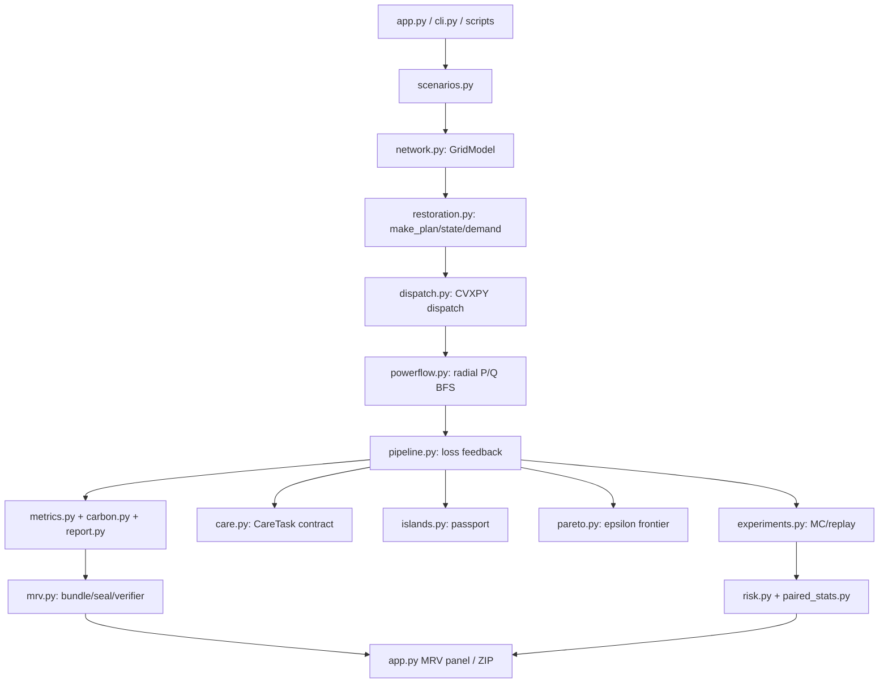

# GridRescue 仓库清单与执行链（Agent Inventory）

> 生成时间：2026-08-23；审计范围：`<GridRescue项目目录>`。本文件是 README 扩写和主代理验收的底稿；不替代 README，也不修改 README。

## 1. 项目定位

GridRescue 是一个 Python 3.11 的配电网灾害恢复数字孪生原型：在 IEEE/MATPOWER `case33bw` 33 节点径向馈线模型上，生成灾害/故障状态，做拓扑恢复、节点化资源调度、径向 P/Q 潮流校验、生命线任务（CareTask）合同校验、碳排 MRV 封存/验证、Monte-Carlo 尾部风险与 Pareto 受控服务预算扫描，最后由 Streamlit 工作台展示。

核心约束是“服务合同先于低碳主张”：医院和关键服务不达标的候选不会进入严格同服务前沿；物理不可行、孤岛无成网电源、潮流不收敛或 MRV 证据被篡改的候选保留在失败表中并被撤回推荐。

## 2. 顶层目录、用途与入口

| 路径 | 用途 | 关键内容/产物 |
|---|---|---|
| `app.py` | Streamlit 评委/演示入口 | 决策工作台、网络图、Pareto、孤岛护照、Care、MRV 只读复核和 ZIP 下载 |
| `src/gridrescue/` | 可安装业务包 | 网络、场景、恢复、调度、潮流、指标、MRV、风险和统计模块 |
| `scripts/` | 一次性构建/审计/批处理命令 | 图表、提交包、MRV 敏感性、Monte-Carlo、风险报告、smoke test |
| `tests/` | pytest 回归测试 | 当前测试文件覆盖应用、核心物理、MRV、Pareto、Care、风险、场景 catalog |
| `data/` | 原始/静态输入 | `case33bw.m`（MATPOWER 原始网络）、`factor_registry.csv`（排放因子注册表） |
| `artifacts/` | 运行产物与证据冻结区 | 单场景 CSV/报告/MRV、Pareto、MC、Wave10/11 发布证据、图表 |
| `docs/` | 面向评委、申报、审计和 README 的说明 | 事实源、主张字典、合同报告、图表与 Mermaid 资产 |
| `research_wave/` | 研究迭代记录 | wave1–11 的物理、MRV、业务、UX、竞品和风险研究 Markdown |
| `pyproject.toml` | 构建/依赖/pytest 配置 | setuptools，`src` layout，Python >=3.11，pytest testpaths |
| `requirements.txt` | 直接安装依赖 | numpy/pandas/networkx/cvxpy/streamlit/plotly/pytest |
| `release_manifest_*.json` | 发布包索引 | 文件清单、hash、版本/波次提交快照 |

### 推荐命令入口

```powershell
cd <GridRescue项目目录>
$env:PYTHONPATH="$PWD\src"
python -m pytest -q
python -m gridrescue.cli --scenario "暴雨内涝" --output artifacts/flood --created-at "2026-08-22T18:00:00+08:00"
python -m gridrescue.mrv verify artifacts/flood/mrv/run-*
python -m gridrescue.pareto --scenario "暴雨内涝" --strategy "最小失供恢复" --fractions "0,0.04,0.05,0.06" --output artifacts/pareto_flood
python -m gridrescue.experiments --count 30 --seed 20260822 --output artifacts/mc30
python -c "from gridrescue.scenario_catalog import write_catalog; write_catalog('artifacts/wave10/catalog')"
streamlit run app.py
python scripts/smoke_demo.py
```

## 3. 总体架构与调用链



### 单场景主链

`run_pipeline()` → `build_ieee33()` + `get_scenario()` → 三策略 `simulate_strategy()` → 每小时节点化调度 → P/Q 潮流验证 → 最大 8 次线损反馈（收敛阈值 0.10 kW）→ `RecoveryMetrics`/`CarbonBreakdown`/Markdown 报告 → CLI 导出 CSV、孤岛护照、Care 结果和 MRV bundle。

### 受控服务 Pareto 链

`scan_pareto()` 先为医院、其他关键、普通服务求词典序锚点，再对普通负荷施加公开 epsilon 预算；每个候选调用 `solve_strategy_with_feedback()` 重跑 dispatch + physical feedback，并把合同失败、物理失败、Care 失败保留在 `pareto_failures.csv`，仅合格点进入 frontier。

## 4. `src/gridrescue` 模块说明

### 4.1 基础输入与模型

#### `case33_data.py`
- 位置：`src/gridrescue/case33_data.py`
- 用途：内置并校验 MATPOWER `case33bw` 的常量（BASE_KV、BASE_MVA、33 个母线负荷、37 条支路含 5 条 tie）。
- 原理：数据文件 `data/case33bw.m` 的固定快照通过 `SOURCE_SHA256` 绑定；网络构造时保留原始 R/X 和节点负荷。
- 输入/输出：无函数输入；导出静态 tuple/list 和源文件 hash。

#### `network.py`
- 关键对象：`GridModel(nodes, branches, root_node=0, base_mva=10, base_kv=12.66, ...)`。
- `build_ieee33(seed=2026)`：把 case33bw 转成节点/支路 DataFrame，并加入项目工程假设：critical_level、PV（节点 10/17/24/29/32）、BESS（13/29）、柴油机（17/29）、节点类型、支路热限额。
- 热限额假设：联络线 1,800 kVA；主干分段 5,200/3,800/2,200/1,600 kVA。MATPOWER rateA/B/C 缺失，因此 `capacity_assumption` 明示为工程假设。
- `graph_from_state(model, failed, closed_ties)`：依据故障支路和闭合联络线生成 NetworkX 图。
- `root_component()`、`islands()`、`is_radial()`：找根节点连通分量、全部岛屿和“边数=节点数-1”的径向性。

#### `scenarios.py`
- `DisasterScenario`：场景名、描述、故障支路、修复时长、PV 降额、购电碳倍数、抢修距离、环境温度；`__post_init__` 校验长度和 PV 范围。
- 内置：暴雨内涝、台风、极端高温。
- `hourly_profiles()`：24 小时确定性负荷曲线（昼夜正弦 + 晚峰 + 高温附加峰 + 固定 seed 噪声）、日照 PV 曲线和时变 grid carbon。
- `sample_fault_scenarios(n, seed)`：固定随机种子生成多故障压力场景，用于 MC。

### 4.2 故障、恢复与调度

#### `faults.py`
- `evaluate_state()`：对故障支路与 tie closure 做拓扑合法性检查；故障支路从图移除，联络线按动作加入，发现环路或不存在支路即报错。
- `component_load_kw()`：给定组件计算基础负荷总和。
- `close_ties_greedily()`：遍历候选联络线，按 load/critical/pv 增益试闭合，保留不成环且增益最大者，直到无收益。
- `branch_downstream_score()`：临时断开支路，统计根节点失联下游负荷（critical 模式会按 critical_level 和 PV 加权）。

#### `restoration.py`
- `STRATEGIES = (传统顺序恢复, 最小失供恢复, 碳韧协同恢复)`。
- `make_plan()`：传统策略按故障输入顺序；EENS/碳韧按 `downstream_score / repair_hours` 降序，并启用 load-greedy tie closure。碳韧与 EENS 保持相同物理修复序列，差异来自资源权重/服务合同，避免拓扑优势混入碳比较。
- `state_at_hour()`：按完成时间将支路从 failed 集合中移除，并输出当小时安全 tie 集合、组件键。
- `build_demand_frame()`：聚合 critical/normal/PV/碳因子/并网容量等时序输入。
- `build_node_demand_frame()`：逐节点×小时输出 `component_key`、root 标识、服务类别（hospital/essential/critical/normal）、PV、BESS、柴油和无功比。
- `strategy_weights()`：给三策略不同 CVXPY 目标权重；碳韧策略提高 carbon/renewable 代价并保留服务下限。
- `simulate_strategy()`：24 小时闭环，调用 dispatch、metrics、carbon、report，返回 `StrategyResult(plan,demand,dispatch,carbon,metrics,report)`。

#### `dispatch.py`
- 配置对象：`ResourceConfig`（SOC、效率、功率/能量、柴油上限）、`DispatchWeights`（关键/普通失供、柴油、购电、碳、BESS throughput、弃光）、`ServiceContract`（医院/关键/普通 EENS cap、carbon cap、Care task requirements）、`DispatchObjective`（weighted 或词典序次级权重）。
- `dispatch_resources()`：聚合模型的 CVXPY 连续优化。变量为 served critical/normal、grid、diesel、charge/discharge、curtail、SOC；约束含功率平衡、grid/柴油/PV/BESS/SOC 上下限和可选 EENS cap。目标是加权失供 + 柴油/购电成本 + 碳 + BESS throughput + 弃光。
- `dispatch_resources_spatial()`：逐节点逐组件优化。根组件才可使用 grid；非根岛必须由柴油/BESS 形成 GFM 候选，否则该组件服务强制为 0、PV 全弃。按组件施加 P 平衡、Q 支撑、潮流损耗和服务 cap，保留 aggregate schema。
- 求解器：CLARABEL，允许 `OPTIMAL`/`OPTIMAL_INACCURATE`；失败抛 `RuntimeError`，上层 MC 会按行隔离。

#### `powerflow.py`
- `SnapshotFlow`：收敛标志、迭代次数、电压上下界、P/Q 损耗、根 slack、支路与节点表。
- `_bfs_power_flow()`：径向网络 per-unit backward/forward sweep；后向聚合子树 P/Q，前向按 R/X 更新电压和支路流，直到电压/流量残差收敛。
- `solve_base_case()`：对 canonical 正常开 tie 基线求一次潮流，供回归 golden values。
- `validate_dispatch()`：逐小时按实际 topology 和节点 dispatch 做潮流，输出 hourly/branches/nodes/components；任何孤岛无 slack、功率缺口、低电压、热限额超限或不收敛会标记 `is_feasible=False`。

#### `pipeline.py`
- `run_pipeline(scenario_name)`：单场景三策略总入口。
- `run_scenario(DisasterScenario)`：接受自定义场景。
- `_simulate_with_loss_feedback()`：先调度，再潮流；把每节点 P/Q 损耗和组件可服务上限回灌，最多 8 轮，若最大残差 <=0.10 kW 视为收敛。
- `PhysicalFeedback` 保存 `node_loss_kw`、`node_q_loss_kvar`、`component_served_caps_kw`、收敛和迭代数；`PipelineResult` 汇总 model/scenario/strategies/validations/comparison/feedbacks。

### 4.3 指标、碳与报告

#### `metrics.py`
- `RecoveryMetrics` 字段覆盖 EENS、critical recovery、柴油、新能源消纳、总碳、24h 服务统计。
- `calculate_metrics()`：按 1 小时时步长从 dispatch 和 carbon 计算 EENS、恢复率、能量和碳。
- `comparison_table()`：把三策略指标拼成 DataFrame，供 CLI/Streamlit/CSV。

#### `carbon.py`
- `EmissionFactors`：grid_base_kg_per_kwh、diesel_kg_per_kwh、vehicle_kg_per_km。
- `CarbonBreakdown`：购电、柴油、抢修车辆、总排放、机会损失（弃光）等分项。
- `calculate_carbon()`：按 dispatch grid/diesel 与 scenario crew distance 逐项核算；恢复电量不直接当减排，新能源弃电单列机会损失。

#### `report.py`
- `markdown_report()`：将场景、策略、修复动作、指标和碳分解生成可读 Markdown；CLI 在其后追加 P/Q/孤岛/Care 验证摘要。

### 4.4 生命线、孤岛护照和 MRV

#### `care.py`
- `CareTask` 字段：task_id/name/node/tier/min_kw/time window/deadline/min_duration/电压上下限/dependencies/data_class。
- `default_care_tasks()`：ICU_CONTINUITY、EMERGENCY_SURGERY、MEDICINE_COLD_CHAIN、EMERGENCY_COMMUNICATION 四项合成赛事模板。
- `validate_care_tasks()`：范围、节点、时窗、依赖图 DAG 和 tier 校验，依赖循环快速失败。
- `care_task_requirements()`：把任务转换为 dispatch 的 `ServiceTaskRequirement` 硬功率约束。
- `evaluate_care_tasks()`：按逐时节点服务、电压证据计算完成状态；单独检查任务电压门，不把“整网可行”当作任务可行；连续时长用 longest true run 和首个满足窗口。
- `write_care_tasks()`：输出 `care_tasks_*.csv/json` 及定义 hash。

#### `islands.py`
- `build_island_passports()`：每个非根组件每小时生成 capability card：GFM 候选、黑启动状态、P/Q/SOC/V/热限、服务负荷、最弱约束、hard reason code。
- GFM/黑启动语义明确：柴油/BESS 容量只能推断“候选”，不能冒充现场 inverter mode/commissioning evidence。
- `_episode_ids()`：按稳定 component key 和连续小时切 episode ID；`write_island_passports()` 导出 hourly/episodes CSV。

#### `mrv.py`
- 证据结构：`inputs/`（factor registry、配置）、`outputs/`（activity/inventory/action/claim gates）、`evidence/`（manifest、verification、seal、index）。
- canonical hash：JSON 排序、浮点六位语义归一化、SHA-256；记录 hash 排除自身 `record_hash`。
- `write_mrv_bundle()`：写活动账、kgCO2 inventory、动作链、factor snapshot、claim gates、run manifest，并生成最终 seal。
- `verify_mrv_bundle()`：检查文件 hash、行级语义 hash、跨表外键、碳方程、action terminal hash、schema/time_step_h、缺失或篡改文件；结构化返回 `verified/errors/checked_files`。
- Claim gate 分离：strict same-service、controlled service budget、inventory-only；当前项目明确不是严格同服务碳降低主张。

### 4.5 统计、风险与实验编排

#### `experiments.py`
- `run_single_scenario()`：对单场景三策略运行，异常变成 row-level failure，不中止批处理。
- `run_monte_carlo(n, seed)`：生成场景、记录结果/物理指标/失败原因/输入 hash；失败分母显式保留。
- `summarize()`：只对成功 rows 计算均值，并附 bootstrap mean interval/Wilson interval。
- `build_failure_manifest()`/`write_failure_manifest()`/`replay_failure_manifest()`：把失败场景定义和策略失败写成可重放 JSON，支持 zero-failure batch。

#### `scenario_catalog.py`
- `build_catalog()`：固定 `root_seed=20260822` 生成 3 灾种 × 3 强度 × 4 复本 = 36 条 `ScenarioRecord`。
- 每条记录有 canonical payload、SHA-256 scenario_id 和 replay inputs；`write_catalog()` 生成 `catalog.csv` + `catalog_manifest.json`。

#### `pareto.py`
- `ParetoScanSpec`：策略、普通服务 allowance fractions、反馈迭代/容差、合同容差、Care tasks、输出目录。
- `_solve_anchor()`：医院→其他 essential→normal 的两阶段词典序服务锚点；锁定上一层最优服务后优化下一层。
- `scan_pareto()`：每个 epsilon 点重跑物理反馈、合同与 Care；`_mark_nondominated()` 按 carbon/EENS 标记 frontier；输出 points/frontier/failures/care evaluations 和 artifacts。

#### `risk.py`
- `cvar(values, alpha=0.95)`：经验上尾 CVaR；失败行作为显式失败损失，不当 0。
- `summarize_risk()`：按策略计算 P95、CVaR95、failure rate/budget、EENS/碳尾部。
- `choose_strategy()`：从 eligible summaries 中选最低风险分数。

#### `mrv_sensitivity.py`
- `lhs_uniform(n, seed)`：可复现 Latin Hypercube [0,1] 样本。
- `propagate_factor_uncertainty()`：固定 activity inventory，仅对 factor registry 的 uncertainty_pct 做 500 次扰动，输出 kgCO2 区间和排名稳定率。

#### `paired_stats.py`
- `paired_deltas()`：按 scenario/strategy 配对两种策略，仅成功配对才计算 delta，失败仍计数。
- `summarize_pairs()`、`bootstrap_mean_delta()`、`wilson_interval()`：均值差、确定性 bootstrap、成功率区间。

#### `facts.py`
- `FACTS` 是冻结竞赛事实源；`validate_text()` 扫描文案中禁止的 strict same-service、CO2e 等主张碎片。
- 对应文件：`docs/competition_factsheet.yaml`、`docs/claim_dictionary.md`、`docs/evidence_index.csv`。

## 5. 应用入口 `app.py`

Streamlit 页面在单文件内组装，先用 `cached_pipeline()` 读取 `artifacts/wave10/pipeline_cache/{flood,typhoon,heat}.pkl`（删除缓存或 `GRIDRESCUE_FORCE_LIVE=1` 可现场重算），再按场景/策略/小时展示：

1. 评委决策工作台（推荐候选、Care/Physics/MRV 三门、FROZEN EVIDENCE）；
2. 策略指标与恢复时间线；
3. 网络拓扑与节点/支路潮流图；
4. Pareto 受控服务预算；
5. 岛屿能力护照；
6. CareTask 任务合同；
7. Wave11 CVaR 风险卡与 MRV 因子不确定性；
8. MRV 现场只读验证、seal 状态和 ZIP 下载。

`resolve_mrv_bundle()` 只接受场景名与 network SHA-256 匹配的 bundle；`load_mrv_ui_state()` 同时做 live verifier、manifest/seal/claim gate 一致性检查，失败会在 UI 里显示而不是静默放行。

## 6. `scripts/` 命令清单

| 文件 | 作用 | 主要输入/输出 |
|---|---|---|
| `smoke_demo.py` | 启动 Streamlit、轮询页面、做演示烟测 | localhost 页面状态 |
| `build_figures.py` | 从正式 Wave10 CSV 生成 7 张 PNG 与 source index | `docs/assets/readme/*.png`、`artifacts/wave10/figures` |
| `build_submission.py` | 按白名单收集代码/文档/证据、写 ZIP 与 SHA-256 | `outputs/GridRescue_*.zip` |
| `check_submission_ready.py` | 检查提交包结构、manifest、测试和禁止 claim | JSON/退出码 |
| `run_wave10_batch.py` | 批量 36 场景执行并写实验表 | `artifacts/wave10/batch36` |
| `build_risk_report.py` | 从实验 CSV 计算风险/CVaR | `artifacts/wave11/risk_report` |
| `build_mrv_sensitivity.py` | 执行 500 次因子 LHS | `artifacts/wave11/mrv_sensitivity` |
| `build_paired_report.py` | paired delta/bootstrap/Wilson 报告 | paired CSV/Markdown |
| `build_c0_c4_gate.py` | 计算 C0/C4 主张资格门 | `artifacts/wave10/c0_c4_gate` |
| `audit_claims.py` | 扫描 Markdown 是否使用禁止主张 | 文本审计退出码 |
| `run_strict_contract_demo.py` | 三灾种严格 Care/Pareto 合同 demo | `artifacts/wave10/strict_contract_demo` |

## 7. `tests/` 测试矩阵

| 测试文件 | 覆盖内容 |
|---|---|
| `test_core.py` | IEEE33 径向/连通、阻抗和 base flow golden、故障/tie 合法性、三策略有限指标、物理验证、无源孤岛硬失败 |
| `test_care.py` | 默认任务完成、重叠任务不重复计服务、功率窗/导出、电压门独立、非法定义 fail-fast |
| `test_mrv.py` | 因子 hash、运行时/静态 registry、活动与碳方程、动作 hash 链、正常/篡改/缺失 bundle、claim gate、非小时数据拒绝 |
| `test_experiments.py` | MC 行级失败隔离、失败分母、摘要置信区间、failure manifest 精确重放 |
| `test_pareto.py` | 节点服务类别、物理可审计 frontier、失败 epsilon 保留、不可满足 Care anchor |
| `test_islands.py` | source-free/GFM 护照状态、episode/导出 schema、空非根岛稳定 schema |
| `test_risk.py` | 上尾 CVaR、失败行不归零 |
| `test_mrv_sensitivity.py` | LHS 可复现、因子不确定性保持策略行 |
| `test_paired_stats.py` | 失败配对计数、delta/bootstrap 确定性、Wilson 区间 |
| `test_scenario_catalog.py` | 36 条 catalog、manifest hash/determinism、行重放到 DisasterScenario |
| `test_app_mrv.py` | MRV UI live verified、下载 ZIP、场景错配不复用、篡改可见 |
| `test_app_workbench.py` | 三门决策工作台与 NO_GFM preset 的 BLOCKED 渲染 |
| `test_facts.py` | 冻结事实、禁止 strict same-service 和 CO2e 文案 |

## 8. 产物目录速查

### 单场景（例如 `artifacts/flood_v08/`）

- `network_nodes.csv` / `network_branches.csv` / `network_manifest.json`：网络和 source hash；
- `base_powerflow_nodes.csv` / `base_powerflow_branches.csv`：基线潮流；
- `dispatch_{traditional,eens,carbon_resilient}.csv`：逐时聚合调度；
- `actions_*.csv`：联络线/修复动作时间线；
- `powerflow_*.csv`、`powerflow_nodes_*.csv`、`powerflow_branches_*.csv`、`powerflow_components_*.csv`：物理验证；
- `island_passport_hourly_<strategy>.csv`、`island_passport_episodes_<strategy>.csv`、`island_passport_summary_<strategy>.json`：孤岛能力护照；
- `care_task_definitions.json`、`care_task_evaluation_<strategy>.csv`、`care_task_summary_<strategy>.json`：生命线任务结果和定义 hash；
- `report_*.md`：策略报告；
- `mrv/run-*/`：MRV inputs/outputs/evidence bundle。

### Wave10/Wave11

- `artifacts/wave10/batch36/`：36 条冻结场景实验、validation、paired delta、failure manifest；
- `artifacts/wave10/c0_c4_gate/`：strict/controlled/inventory-only 主张门；当前 strict eligible 为 0；
- `artifacts/wave10/strict_contract_demo/`：严格 Care/Pareto 合同和失败锚点；
- `artifacts/wave10/figures/`：正式七图及 `figure_source_index.csv`；
- `artifacts/wave11/risk_report/`：CVaR95/P95/failure budget；
- `artifacts/wave11/mrv_sensitivity/`：500 次 LHS 因子区间与排名稳定率。

### README 图和 Mermaid 资产

路径：`docs/assets/readme/`。现有图包括：
- `app_overview.png` / `app_decision_workbench.png`（1600×1000）：Streamlit 总览和评委决策工作台；
- `case33bw_topology.png`（2141×1242）及 SVG：33 节点馈线拓扑；
- `wave10_01_strategy_comparison.png`（1422×808）：三策略指标对比；
- `wave10_02_inventory_breakdown.png`（1422×983）：碳 inventory 分解；
- `wave10_03_physics_voltage_gate.png`（1398×842）：电压/物理门；
- `wave10_04_action_timeline.png`（1382×842）：开关与修复动作时间线；
- `wave10_05_pareto_controlled_service.png`（1537×842）：Pareto 与普通服务预算；
- `wave10_06_mrv_reconciliation.png`（1422×809）：MRV 对账；
- `wave10_07_caretask_contracts.png`（1702×842）：CareTask 合同；
- Mermaid 源与 SVG：`gridrescue_architecture.mmd/.svg`、`claim_gates.mmd/.svg`、`streamlit_tabs.mmd/.svg`。

README 可直接用相对路径 `docs/assets/readme/<file>` 引用这些 PNG/SVG；本清单的架构图也采用同一数据流。

## 9. 运行和验收要点

1. 安装依赖并设置 `PYTHONPATH=src`；
2. 先跑 `python -m pytest -q`，再跑 `scripts/smoke_demo.py`；
3. 单场景 CLI 输出必须存在三策略 dispatch/actions/powerflow/report、Care、island passport 和 MRV bundle；
4. `python -m gridrescue.mrv verify <bundle>` 必须检查 `verified=true`；修改 dispatch/action/索引文件后 verifier 必须失败；
5. Pareto 失败点不能从表中删除，推荐仅来自 frontier；
6. 无源孤岛必须是物理硬失败（不可用虚拟 slack 填平）；
7. 文案经过 `scripts/audit_claims.py` 和 `test_facts.py`，不能将 E 类合成因子写成现场实测/第三方核证，不能把受控普通服务让步写成严格同服务减排。

## 10. 当前已知边界

- 网络电气参数是官方 case33bw；DER 位置、关键等级、热限额为项目假设；
- 恢复序列/tie 选择是启发式，未统一成含整数开关的 MISOCP；
- DER 无功能力采用显式工程近似，尚未逐设备 `P²+Q²≤S²`；
- 故障样本是可复现实验场景，尚未接入武汉 ERA5/Open-Meteo 固化回放；
- 因子数值仍为 E 类 `engineering_prior`/`conditional`；
- 全链固定 `time_step_h=1.0`，扩展 15/30 分钟必须同步修改 SOC、EENS、合同和 MRV。


