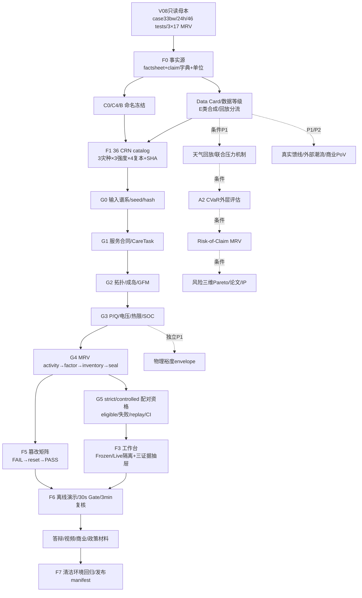

# GridRescue Wave 10 综合风险审计：矛盾、依赖、过度主张与实施前闸门

**正式日期：2026-08-22**  
**审阅范围：** 全部 `research_wave/wave10_*.md`（学术问答、算法前沿、竞品、数据真实感、演示运维、产业商业、IP/专利、评委心理、月球想法、论文路线、政策标准、产品 UX、范围评分、综合 ideas/roadmap、验证故事、视觉故事）。  
**目的：** 在任何生产代码或材料改动前，统一事实口径，识别相互牵制的交付物，并建立可执行的 pre-implementation gate。本文只做综合审计，不修改生产代码。

---

## 1. 总体判断

Wave 10 报告之间的主线其实一致：先守住 V08 可信基线，再做 36 个 CRN 配对实验、strict/controlled 分轨、三门 gate、失败 replay 和 MRV 篡改演示；CVaR、天气回放、物理裕度、专利和商业化均应是条件增量。真正的风险不是缺少点子，而是**同一事实在不同材料中被不同命名/数字/强度表达**，以及把“计划设计”误写成“已完成证据”。

**统一总原则：**
- V08 是只读母本；Wave 10 新结果进入独立目录，不覆盖 V08。
- 任何推荐必须依次通过服务、物理、证据三门；失败保留且进入分母，不填零。
- `same_service_pass=false` 时只能写“受控服务预算下的运行碳清单差异”，不能写严格同服务减排/严格碳优势。
- E 类合成数据、合成天气、CareTask 模板、固定排放因子均必须带数据等级和假设标签；不冒充现场/临床/实时测量。
- 主路径必须是冻结工件的离线/Replay 演示；Live exploration 与 Frozen Evidence 明确隔离。

---

## 2. Top 20 矛盾、隐藏依赖与过度主张风险

| # | 类型/等级 | 发现（跨报告对照） | 影响 | 实施前统一动作 |
|---:|---|---|---|---|
| 1 | **事实矛盾 P0** | 测试数出现“28 项/成果”与 V08 `46 passed`；`academic_qa`、`synth_roadmap`要求统一为 46。 | 答辩、README、Manifest 相互打脸。 | 建 `factsheet/claim_dictionary`，唯一写法：`pytest 46 passed`，并记录 160.60 s。 |
| 2 | **事实矛盾 P0** | MRV 文件数有 11 files 与正式 bundle 17 files 两种口径。 | 评委可立即判定材料未冻结。 | 统一为 3 bundles×17 files；11 仅标历史草稿，不得出现在 UI/PPT/视频。 |
| 3 | **主张越界 P0** | 三 bundle `same_service_pass=false`，但部分竞品/视觉/商业段落使用“降碳/减排/同服务”缩写。 | 把普通负荷让步误报为严格减排。 | 自动 claim gate：same_service=false 时屏蔽 strict wording，并强制显示 normal EENS Δ、epsilon、claim status。 |
| 4 | **碳边界矛盾 P0** | 弃电在部分叙事被说成“纳入碳核算”，而 README/MRV规定弃电只作机会损失 KPI，不与购电/柴油/车辆相加。 | 清单方程和图表不可复算。 | 主清单仅购电、柴油、车辆（及已定义网损边界）；弃电单列机会损失。 |
| 5 | **灾种口径矛盾 P1** | `competitor_diff` 等早稿列暴雨、台风、冰灾；V08/Wave10冻结为暴雨、台风、极端高温。 | 场景数量、图例、实验分层不一致。 | 正式三灾种固定 flood/typhoon/heat；ice 只能标后续扩展。 |
| 6 | **统计过度主张 P0** | MC30 的 4.83%（29/30 成功）在部分材料像总体效果；`academic_qa/validation_story`明确只是描述性 smoke-test。 | 无配对分母、无预注册 CI 时不能推出因果/总体稳健。 | 所有展示加“smoke-test/29 个成功样本”；36 场景完成前禁报总体效应。 |
| 7 | **样本状态混淆 P0** | 36 场景在多份报告中同时被写成“建议设计”和“将要展示”的既成事实；截至冻结日尚未生成。 | 计划证据被误当现有证据。 | factsheet 分栏 `V08 observed` vs `Wave10 planned/verified`；未生成 catalog 不进入正式 claim。 |
| 8 | **基准工况混淆 P1** | 基准 `Vmin=0.913 pu` 与恢复候选 `Vmin>=0.952545 pu` 并列，未总是注明工况。 | 评委会误判数值自相矛盾或“恢复后更安全”无依据。 | 图表和答辩同页标注 baseline-unrecovered / restored-candidate。 |
| 9 | **时间粒度依赖 P0** | V08 是 24×1h；data_realism/algorithm 提议 15 min、72/168 h weather replay。SOC、EENS、碳账尚未端到端支持非 1h。 | 直接接入高频天气会改变状态转移和指标含义。 | 先锁 24h/1h；非 1h 只能 P1 数据 QA，不得进入正式 KPI。 |
| 10 | **实时性过度主张 P0** | UX/visual 使用“LIVE/实时”字样；industry/academic 明确当前是离线预案、人工确认、非 SCADA/OMS 控制。 | 演示被误听成生产实时调度。 | UI 固定 `FROZEN EVIDENCE`/`LIVE EXPLORATION` 标签；主路径只读 replay，文案写“现场交互/离线重算”。 |
| 11 | **数字孪生/真实资产越界 P1** | `digital twin`、医院生命线、气象/故障概率等表述容易被理解为现场或临床标准；实际为 case33bw + E 类合成工程输入 + 合成 CareTask。 | 学术和产业可信度受损。 | 统一称“预案级决策孪生原型”；每页显示 E 类、合成模板、非临床/非现场标签。 |
| 12 | **算法实现状态矛盾 P0** | algorithm_frontier/paper_roadmap 提议 A2 CVaR、A9 catalog、A11 risk-MRV；V08 代码尚未实现，synth_roadmap又要求 P0 先于可选 CVaR。 | 提前改接口会拖垮主批，或把研究设计写成已实现。 | CVaR 设条件闸：P0 全绿、剩余净工时≥8h、先外层评估后入 MRV；否则赛后路线。 |
| 13 | **模型能力越界 P1** | moonshots/IP/论文列 GNN、RL、MISOCP/AC-OPF、两阶段随机规划；其他报告明确十日 CUT，现有链是启发式+P/Q反馈。 | 依赖新求解器/标签/重写调度，破坏回归稳定性。 | 将 GNN/RL/MISOCP/完整 DRO 标为 CUT；不得进入 release 依赖或竞赛主张。 |
| 14 | **Carbon-SOC 依赖缺失 P1** | carbon_soc 研究写得很细，但 V08 没有来源账本、初末 SOC 合同、隔离对照。 | 可能误写储能零碳或碳优势。 | 只报告 SOC 与运行清单；Carbon-SOC 仅列 future work，禁止绩效结论。 |
| 15 | **物理闭合不完整 P0** | P/Q、V、热限已校验，但 DER `P²+Q²≤S²`、无功吸收—充电—弃光闭环、保护/短路/频率/谐波/UPS 未覆盖。 | “物理可行”被误解为全电气安全。 | 物理 gate 名称限定为平衡三相、径向、24h 模型边界；未覆盖项进入 limitations。 |
| 16 | **GFM/成岛证据不足 P0** | NO_GFM/source-free island 会 BLOCKED；但成岛 passport 部分字段是模型推断/未知，不证明现场黑启动、燃料、频率/谐波能力。 | 现场可运行性被过度承诺。 | `GFM/black-start=unknown` 必须阻断推荐；反例固定 `BLOCKED:NO_GFM` 并保留原因链。 |
| 17 | **strict/controlled 命名依赖 P0** | 报告交替使用 B/C0/C4/A/B/C′；容易把 C4 受控预算结果并入 C0 严格比较。 | 配对统计和表格 join 错位。 | 统一枚举：`B=risk-neutral baseline`、`C0=strict same-service`、`C4=controlled epsilon`；结果分两张表，禁止替代。 |
| 18 | **UI 范围冲突 P1** | UX/judge 既要求“8 Tab”，又要求“1 工作台+3 证据抽屉”；scope 明确首屏收敛。 | 交互蔓延、现场点击超时。 | 生产首屏只保留 1 workbench + 3 drawers + 追问入口；其余 Tab 仅 LIVE exploration。 |
| 19 | **演示时长与路径依赖 P1** | 30 秒 Gate、3 分钟复核、5 分钟答辩、视频 180/300s 等多套时长口径。 | 演示脚本无法稳定验收。 | 固定三层：30s Gate、≤3min 复核≤8 clicks、5min 答辩；视频按比赛要求另出 180s/300s 版本。 |
| 20 | **商业/政策/IP 过度主张 P0** | industry 明确无真实客户/订单/ROI；policy/IP 报告有认证、专利、标准映射语言，易被读成合规/商业已成立。 | 法务、评委会追问证据来源。 | 统一“TRL4、待验证 PoV、ROI 基线采集、内部 MRV”；政策只作映射，IP 只作 prior-art/FTO 预筛，不称认证/核证/已授权专利。 |

### 其他需记录的数值/实现陷阱

- `alpha=0.90/0.95` 在 S=12 时 tail 太小；正式风险展示优先 S≥30、明确 `tail_count`。
- A2 示例 `L_s = 1000E_H + 100E_K + 500·deadline_miss + RRT` 的单位和权重需在 factsheet 固化，否则不同报告会产生不可比 CVaR。
- Paired bootstrap、Wilson、McNemar、ITT/reliability 分母必须共享同一 `eligible` 定义；失败不能填 0，也不能静默删除。
- 36 catalog 结构是 3 灾种×3 强度×4 复本=36；A/B/C0/C4 必须读取同一 scenario JSON/SHA，不能各自重新采样。
- 外部 MATPOWER/pandapower 对照、weather replay、真实馈线映射均属 P1/P2；在 P0 未冻结前不得成为阻塞依赖。

---

## 3. 依赖图（实施顺序）

**硬依赖解释：**
1. 没有 F0，任何 UI、PPT、视频和论文数字均不可冻结。  
2. 没有 F1/G0，不能做配对统计；没有 G1–G3，候选不能进入碳比较。  
3. G4 是 claim 的证据底座；G5 才能产生严格/受控差异和 CI。  
4. UI/演示依赖冻结工件，不得反向触发长时求解。  
5. CVaR、天气、真实数据是旁支，只有 P0 全绿后才可接入；它们不能阻塞发布，也不能覆盖 V08。

---

## 4. Pre-Implementation Gate Checklist（开工前必须逐项通过）

### A. 事实与范围锁（F0）
- [ ] 冻结日期统一为 **2026-08-22**；所有新结果标明 Wave10 batch/date。
- [ ] 建立 canonical factsheet、数字字典、证据索引和禁止主张表；UI/PPT/视频/README 仅从此处读取。
- [ ] 统一数字：V08 `46 passed`、160.60 s、3 bundles×17 files、单位 `kgCO2`。
- [ ] 固定灾种 `flood/typhoon/heat`；ice、真实天气、现场概率标为后续。
- [ ] `same_service_pass=false` 的严格文案自动阻断，并显示 epsilon、normal EENS Δ、claim status。

### B. 数据与谱系锁（F1）
- [ ] `artifacts/v08_official`、V08 manifest/SHA 只读；Wave10 输出隔离至 `artifacts/wave10/<batch_id>`。
- [ ] 每个输入具备 data_id、等级（B/D/E/DERIVED）、来源/许可证、单位、时区、缺失率、生成器版本、seed、SHA。
- [ ] E 类合成网络、DER、CareTask、碳因子、天气明确标注“工程假设/合成”，不得混入现场 claim。
- [ ] 72/168h weather replay 与 15min 粒度若未端到端验证，不得写入正式 KPI；默认保持 24×1h。

### C. 场景与比较资格（F2）
- [ ] 生成并冻结 36 个 JSON：3×3×4，分层和复本数可核对，catalog SHA 稳定。
- [ ] A/B/C0/C4 对同一 scenario_id 使用同一输入 JSON/SHA、网络/Care/factor/config hash。
- [ ] 枚举统一：B baseline、C0 strict、C4 controlled epsilon；两条结果表分离。
- [ ] G0–G5 waterfall 已实现：输入→服务→拓扑/成岛→物理→MRV→比较资格。
- [ ] 失败保留 failure_phase/reason、ITT/reliability 分母、replay 入口；任何失败不填 0、不静默删除。

### D. 统计与风险闸门
- [ ] 预先写明主终点（critical EENS、Care pass、minV/max loading/source adjustment）和次终点（kgCO2、normal EENS、柴油等）。
- [ ] paired delta、eligible 定义、Wilson/McNemar/bootstrap 方法和随机 seed 已冻结；报告 `n_eligible/36`。
- [ ] CVaR 若进入：alpha、tail_count、LifeLineLoss 权重/单位、OOS catalog 与 tune/test split 固化；S<30 不做 0.90/0.95 主结论。
- [ ] risk spec/catalog/tail/alpha 纳入 MRV verifier；篡改任何字段必须 FAIL。
- [ ] strict eligible 太低或 CI 不稳定时，自动降级为可靠性/失败机制报告，撤回总体效应。

### E. 物理与成岛闸门
- [ ] 物理结论限定在平衡三相、径向、24h 模型边界；保护、短路、频率、谐波、UPS 明确列为未覆盖。
- [ ] P/Q 平衡、潮流收敛、Vmin、热限、source adjustment、SOC、DER kVA 约束逐时可追溯。
- [ ] `GFM/black_start=unknown` 或 source-free island 自动 `BLOCKED:NO_GFM`；反例有确定性 fixture。
- [ ] baseline Vmin 与 restored Vmin 在图表中按工况分列；不得混用阈值。

### F. MRV、UI 与演示闸门
- [ ] MRV activity→factor→inventory→claim gate→seal/verify 可重算；验证 PASS 只表内部完整性，不表第三方核证。
- [ ] tamper/delete/rechain 8–10 类 fixture：FAIL→reset→PASS，且官方 V08 SHA 不变。
- [ ] 首屏为 1 workbench+3 evidence drawers；其余功能标 LIVE exploration，主路径读取冻结工件且不触发长求解。
- [ ] 30s Gate 可跳过/重播/reduced-motion；≤3min 复核、≤8 次点击；5min 答辩脚本另行固定。
- [ ] 主推荐、受控候选、NO_GFM 反例均可一键切换；反例无推荐 CTA；每句台词有 run/source 路径。

### G. 发布与商业/政策/IP闸门
- [ ] 清洁断网环境可运行 pytest、AppTest、V08 verify、Wave10 replay 和 tamper reset；manifest/SHA 全一致。
- [ ] 所有绝对路径、用户名、学校/客户信息、临时 API key 已清除；ZIP 可独立复核。
- [ ] 商业材料只写 TRL4、离线 PoV/桌面演练、12周验证设计和 ROI 基线；无订单、收入、真实客户或回本期暗示。
- [ ] 政策材料只做条款映射/设计依据；不写“认证通过、法定核证、碳资产签发”。
- [ ] IP 材料完成 prior-art/FTO 预筛和证据留存；“可申请专利”与“已获授权”分开。
- [ ] F0–F7 冻结点签字：F0事实、F1 catalog、F2统计、F3 UI、F4反例、F5 MRV/图、F6叙事、F7发布。

---

## 5. 结论与停止规则

**可开工条件：** A–C 全部通过，且 V08 golden 回归先绿；否则停止新增算法和 UI。  
**可进入 CVaR/天气 P1：** A–F 的 P0 全绿、至少两次完整离线演示通过、剩余净工时不少于 8 小时。  
**强制止损：** 任一 P0 事实冲突、strict eligible 过低、MRV tamper 未能稳定 FAIL、主路径触发长求解、或任务超估时 150% 时，立刻回退到 V08 + factsheet + 失败 replay + 静态证据包。  

最终交付应是：**V08 可信基线 + 36 CRN 配对证据 + 三门推荐资格链 + MRV 反错演示 + 可恢复离线提交包**；其余算法、真实数据、商业化和专利均在对应证据闸门通过后再升级。
