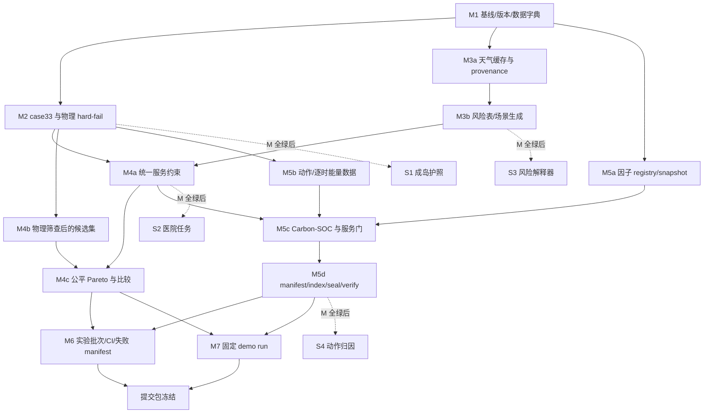

# GridRescue Wave 5：10 天主冲刺范围管理与提交控制

**计划基准日：2026-08-22（周六）**  
**主开发冲刺：2026-08-24 至 2026-09-02（D1–D10，10 个自然日）**  
**提交截止：2026-09-13 前；建议最终提交冻结：2026-09-10 18:00。**

> 本文只做范围、依赖、验收和风险控制，不修改代码。目标不是在十天内堆满所有研究方向，而是形成一个能被复跑、被质疑、被演示、被克制表述的竞赛软件提交包。

---

## 0. 冲刺合同：唯一成功定义

### 提交时必须能成立的一句话

> GridRescue 在固定、可追溯的极端天气情景与 IEEE 33 节点网络输入下，生成经过拓扑/供需/潮流后验可行性筛查的恢复候选，按**同服务门控**比较韧性与恢复阶段运行碳排，并为每次展示结果提供输入、因子、动作和输出的复算证据。

### 本冲刺不追求的事

- 不把 IEEE `case33bw` 合成推演讲成真实武汉馈线或生产级调度系统。
- 不把“少供电”写成减排；服务等价或物理门失败时，只展示清单、EENS 和失败原因。
- 不把无真实故障工单标签的工程先验包装为已泛化的 AI 预测模型。
- 不在 D8 之后继续扩展算法面；D8–D10 的任务是封存、复跑、演示和材料一致性。

### 当前基线（用于范围判断）

仓库已有三类灾害、三策略、case33 网络、24 小时调度/潮流后验校验、Monte Carlo、Streamlit 和导出链路。现有测试共 **13 个**（`pytest --collect-only -q`），覆盖：

1. 33 节点/32 条闭合支路/5 条联络线、基值和源 SHA；
2. `Pd=3715 kW`、`Qd=2300 kvar`、阻抗换算，以及基础潮流 golden 值（损耗、最低电压、slack 功率）；
3. 故障隔离与联络线恢复的径向性；
4. 三策略数值有限、关键负荷恢复范围、碳韧策略与最小失供策略的关系；
5. 30 个合成场景与小批 Monte Carlo；
6. 24 小时 P/Q 后验校验、支路/节点结果和供需平衡；
7. 无成网电源孤岛的硬失败语义；
8. Monte Carlo 单策略失败隔离、置信区间和失败场景 manifest 回放。

这些测试是本计划的**回归底座**；新增功能必须补上自己的失败夹具，且不能破坏上述 13 项语义。

---

## 1. 研究材料如何收敛为一个 10 天产品

下表把 `research_wave/` 全部研究材料压缩为可执行范围，避免多份方案各自正确、合在一起超载。

| 研究簇 | 材料 | 对本冲刺的约束 | 处理决定 |
|---|---|---|---|
| 总体创新与收敛 | `initial_synthesis.md`、`grid_innovations.md`、`ai_twin_innovations.md`、`literature_competitor.md`、`market_story_innovations.md` | 证据链比“概念叠加”优先；主链是天气—风险—恢复—物理—MRV—回放。 | 只保留一个 AI：Risk-to-Action；不做 GNN、RL、泛化聊天机器人、区块链。 |
| 网络和物理 | `case33_powerflow_audit.md`、`wave1_physics.md`、`microgrid_islanding.md`、`wave3_island_passport.md` | canonical 数据、P/Q 校验、无源孤岛、热限额假设和不确定状态必须可见。 | M：基线与 hard-fail；S：成岛护照以派生表/卡片落地。 |
| 天气与风险 | `weather_risk_plan.md`、`wave2_weather.md`、`wave5_ai_engine.md` | 历史天气要缓存、哈希、离线回退；无真实标签时输出 `engineering_prior`。 | M：单点 ERA5/Open-Meteo 冻结数据 + 解释风险映射；不训练深模型。 |
| 碳、服务、Pareto | `carbon_mrv_plan.md`、`wave2_carbon_soc.md`、`pareto_cvar_design.md`、`wave2_pareto.md` | 服务等价、Carbon-SOC、因子版本、Pareto 和尾部不确定性决定低碳结论是否成立。 | M：服务门、因子快照、同服务候选和统计；CVaR 只做可解释的样本报告。 |
| 任务和审计 | `wave3_hospital_tasks.md`、`wave3_mrv.md`、`data_provenance.md` | 关键负荷需可解释；动作、因子、输入/输出需要可追溯。 | M：MRV evidence seal；S：最小合成 `CareTask` 抽屉。 |
| 产品、商业、演示 | `demo_ux_plan.md`、`wave4_demo_pitch.md`、`wave4_business_policy.md`、`application_evidence_audit.md` | 固定 demo run、故事一致、TRL/产品边界克制、截图和材料同源。 | M：固定快照、五分钟主线、提交包；商业化写入材料，不开发交易/部署系统。 |
| 性能、质量和统筹 | `scalability_benchmark.md`、`judge_redteam.md`、`wave4_judge_redteam.md`、`subagent_dispatch.md`、`ten_day_execution.md` | 失败不隐藏、性能不臆测、P0 红队质疑先于 UI。 | M：失败 manifest、实验摘要、红队问答证据索引；性能只报实测。 |

---

## 2. MoSCoW：允许提交的最小闭环

### Must — 缺任何一项都不进入“可提交”状态

| ID | 交付范围 | 可验收定义（Definition of Done） | 明确边界 |
|---|---|---|---|
| M1 | **可复现基线与输入冻结** | canonical network/weather/factor/run 输入有 SHA-256、版本、日期、seed、依赖锁和 `run_manifest`；所有图表带 run short-id。 | 不要求真实馈线、GitHub 发布或完整 CI；但本地版本和文件哈希必须齐。 |
| M2 | **物理可信底座** | case33 固定数据、单位、常闭/常开、基础 golden 潮流、径向性、无源孤岛、P/Q 后验校验持续通过；热限额有独立假设表和敏感性标签。 | 不承诺联合 AC-OPF/MISOCP 全局最优；候选恢复方案必须经 hard-fail 筛查。 |
| M3 | **天气到风险到场景** | 一条冻结的历史小时天气数据链（默认 `WH-CENTRE`），原始响应/规范化 CSV/manifest/hash/离线运行齐备；逐支路风险表含风险因子、先验版本、`engineering_prior` 或校准状态，并可生成固定 seed 场景。 | 无真实工单时，不报 AUC/真实泛化；不扩展五天气区。 |
| M4 | **公平的碳—韧性比较** | 每个展示方案在统一资源、同一灾情、同一时间窗下比较；服务门（关键与普通 EENS/任务门）明确；至少有低碳/均衡/高韧三个未被支配、物理可行候选，或明确报告未形成 Pareto 的原因。 | 不强行追求漂亮“降碳百分比”；门失败则关闭减排标签。 |
| M5 | **MRV 与证据封存** | `factor_registry/snapshot`、Carbon-SOC、逐时账本、服务门、动作 ledger、run manifest、evidence index、seal/verify 命令形成闭环；篡改一个受管文件会验证失败。 | 动作级 Shapley/全量因果归因不属于 M；最多对少量关键动作做 leave-one-out。 |
| M6 | **实验与失败透明度** | 三灾害 × 三策略的固定批次、seed、attempt/solved/failed、CI/分位数和 failure manifest 可导出；失败结果不进入指标均值。 | 30 个样本只称“可复现合成压力测试”；N≥500 是后续研究，不阻塞本提交。 |
| M7 | **可演示提交包** | 一个固定 flood demo run，5 分钟主线、离线缓存、截图清单、README 一条核心复跑命令、申报/PPT/视频中数字同源。 | 不现场改参数跑大批 Monte Carlo；不开发新平台或移动端。 |

### Should — M 全绿后才排期；未完成不阻断提交

| ID | 范围 | 进入条件 | 最小交付 |
|---|---|---|---|
| S1 | **成岛能力护照** | M2 的 component/hourly 数据已稳定。 | `island_passport_hourly.csv` + UI 卡片：GFM/功率/SOC/电压/热限额/未知字段、最弱约束。 |
| S2 | **医院生命线任务层** | M4 的服务门已统一。 | 6–12 条匿名合成 `CareTask`；任务状态、截止时间、阻塞原因；不改写优化内核。 |
| S3 | **受约束风险解释器** | M3 风险表完成，且只读取结构化字段。 | 风险原因和预置建议的模板化中文摘要；无自由生成模型。 |
| S4 | **少量动作反事实归因** | M5 ledger/seal 全绿。 | `close_tie`/`repair_branch` 两类动作 leave-one-out；交互余量单列。 |
| S5 | **规模实测小表** | 主线运行稳定、机器规格已记录。 | 33 节点与可得扩展 case 的实测 runtime/P95/可行率，不使用预测数字。 |

### Could — 仅作为展示加分，不纳入提交承诺

- 反事实恢复时间线并排回放与小幅动画；
- 一页 C-RSLA 履约视图；
- `WH-CENTRE` 以外的 5 区天气映射；
- 两个额外人工构造的重灾场景；
- 评分卡式 UI 微交互、录屏转场、黑暗模式。

### Won’t（本版本明确不做）

- 深度 GNN、强化学习、端到端自动开关控制；
- 大规模实时联合 MISOCP/DRO、三相不平衡、保护配合、同期/短路计算；
- 真实 SCADA/DMS/OMS/GIS 双向接入、生产遥控；
- 多抢修队车辆路径和移动储能车联合优化；
- 区块链碳证书、绿证交易、泛化聊天机器人；
- 将 33 节点合成数据训练结果外推为真实武汉配网预测或商业收益。

---

## 3. 依赖图与关键路径



### 关键路径

`M1 → M2 → (M3a/M3b) → M4 → M5 → M6 + M7 → 发布冻结`

- **M2 是第一硬闸**：物理校验或基础 golden 失败，后续 Pareto、碳和 UI 都只保留为调试结果，不能进入答辩主图。
- **M4 是第二硬闸**：缺服务等价，允许展示“权衡候选”，但禁止做“低碳优于”的结论。
- **M5 是第三硬闸**：缺因子来源或 evidence seal，允许演示恢复，但碳结果只能标“待核验草稿”。
- **M6/M7 并行**：实验跑批由 B 线执行时，C 线用冻结 demo run 做 UI/PPT；两者只能读取冻结输入，不互相改模型参数。

---

## 4. 10 天每日可验收产物

### 统一日节奏和容量规则

- 10:00：确认当日唯一验收物、输入版本和 owner。
- 15:00：完成“可运行最小闭环”；若未达到，立即触发当日砍功能规则。
- 17:00：执行回归/复算/截图；18:00：冻结日报、命令和文件 hash。
- 每天预留 **20%（至少 90 分钟）** 只做测试、修错、文档同步；不把这段时间重新填成功能。

| 日/日期 | 主目标（只允许一个主题） | 当日可验收产物 | 验收命令/证据 | 当日冻结与失败处置 |
|---|---|---|---|---|
| D1 / 08-24 | **基线和范围冻结** | `scope.md`、数据字典、输入 hash 清单、依赖 lock、基线测试记录、红队问题—证据索引。 | `pytest --collect-only -q`；完整 `pytest -q` 作为异步/长跑基线记录；生成文件 hash。 | 冻结网络原始源、当前 demo 场景、测试语义。若全量测试不绿，D2 先修回归，不加功能。 |
| D2 / 08-25 | **case33 与物理契约** | canonical bus/branch 导入对照、热限额假设表、base power-flow golden 输出、差异报告。 | 基础 `Pd/Qd`、32+5、树形、损耗/电压 golden；无源孤岛夹具。 | F1：网络/单位/映射不再变。任何物理失败都写入错误日志，不做“放宽阈值”修饰。 |
| D3 / 08-26 | **天气缓存和数据血缘** | 原始天气响应、规范化 hourly CSV、`weather_manifest.v1.json`、离线读取日志、来源/许可/缺失处理说明。 | 在线/`--offline` 输出同一 normalized hash；一个图显示风/雨/温。 | F2：默认 `WH-CENTRE` 和主天气窗口冻结。API 不稳定立刻切缓存，不扩五区。 |
| D4 / 08-27 | **Risk-to-Action 最小链** | `branch_risk_hourly.csv`、fragility prior 配置、场景生成 manifest、风险排序/解释字段、固定 seed 场景集。 | 风险概率范围、单调敏感性、seed 重放相同；输入状态为 `engineering_prior`。 | 若无标签，停止任何训练/校准 KPI；保留解释规则和情景映射。 |
| D5 / 08-28 | **物理筛查与服务门** | 每小时 feasibility/component 表、热/压/平衡 hard-fail 标志、统一服务等价 JSON、候选剔除日志。 | 13 项回归 + 新增“欠压/过载/无源岛/服务不足”拒绝夹具。 | F3：物理/服务门口径冻结。门失败方案从宣传图剔除，仍保留失败记录。 |
| D6 / 08-29 | **公平 Pareto** | 同资源/同场景的 ε 或 ρ 候选表、未被支配标记、`pareto.csv`、比较图和求解日志。 | 所有入围点服务门与物理门均绿；至少解释一个不入围点。 | 若三个可行未被支配点做不出，交付“一个同服务对照 + 敏感性表”，删 Pareto 滑杆但不伪造前沿。 |
| D7 / 08-30 | **MRV、Carbon-SOC、证据封条** | `factor_registry.csv`、`factor_snapshot.csv`、逐时 carbon ledger、action ledger、manifest/index/seal、`verify-run` 结果。 | 篡改 fixture 必失败；少供关键负荷 fixture 不显示减排；储能碳来源可追溯/未知。 | F4：因子版本、边界和主 demo run 冻结。若归因未完成，标 `planned`，不出动作贡献数字。 |
| D8 / 08-31 | **全量实验与可靠性** | 三灾害×三策略固定批次、summary、CI/分位数、失败 manifest/replay、敏感性最小表。 | 批次可重跑；failed 不进均值；每一张主图有 N、seed、时间窗、版本。 | 16:00 后停止改目标函数；长跑超时则缩样本并明确为压力测试，保留失败/超时统计。 |
| D9 / 09-01 | **固定演示和材料同源** | demo bundle、Streamlit 固定快照/状态条、5 分钟脚本、12 张截图、PPT 图表源索引。 | 离线启动、切换小时无等待、所有截图 run-id 一致；三分钟精简版可跑通。 | 没有 M 全绿时，UI 不展示对应模块；宁可隐藏入口，也不展示无证据数字。 |
| D10 / 09-02 | **发布候选包（RC1）** | README、白皮书、答辩 Q&A、复跑脚本、artifacts manifest、checksums、许可证/来源清单、录屏与提交目录。 | 新环境/干净目录按 README 跑核心 demo；全量测试、`verify-run`、hash 清单三绿。 | F5：RC1 只接收 P0 修复。所有新增功能进入 `post_submission_backlog.md`。 |

---

## 5. 2026-09-03 至 2026-09-13：不是第二轮开发，而是交付缓冲

| 日期 | 目的 | 允许动作 | 禁止动作 |
|---|---|---|---|
| 09-03–09-04 | RC1 复测与评委红队 | 重跑、修 P0、核对数字、重录失败镜头。 | 改算法、改因子、改场景、加新页面。 |
| 09-05–09-06 | 文本与证据一致 | 申报书/PPT/视频/README 的单位、run-id、边界、术语对齐。 | 产生新的主结论或换图。 |
| 09-07–09-08 | 两次全流程彩排 | 5 分钟/3 分钟演示，随机追问 50 问，离线演练。 | 临场参数调优。 |
| 09-09 | 最终 hash 与介质备份 | 打包 ZIP、导出 checksum、U 盘/云盘双备份。 | 任何代码和数据改动。 |
| **09-10 18:00** | **最终提交冻结** | 只生成提交副本。 | 一切内容改动。 |
| 09-11–09-12 | 提交窗口缓冲 | 重新上传、文件完整性核验、演讲排练。 | 重新构建产生未核验二进制/图表。 |
| **09-13 前** | **完成提交** | 使用 09-10 产生的冻结包。 | 最后时刻开发。 |

---

## 6. 风险缓冲、触发器与降级路径

| 风险 | 早期触发器 | 保护性动作 | 对外表述/范围变化 |
|---|---|---|---|
| 物理模型回归或 golden 不一致 | D2 15:00 前基础潮流/孤岛测试不绿。 | 停止天气、UI、Pareto开发；先恢复 canonical 数据和既有回归。 | 仅展示“筛查原型”调试结果，不做方案优劣结论。 |
| 天气 API/许可证/字段不可用 | D3 首次请求失败、字段变化、无法保存原始响应。 | 使用已下载缓存；单点+单窗口；记录 API URL、时间戳、hash。 | 不声称实时天气接入或逐杆塔观测。 |
| 无真实故障标签，AI 指标失真 | D4 无可审计事件标签或样本切分不成立。 | 固化为 `engineering_prior` 风险映射，展示单调敏感性而非 AUC/Brier。 | “可解释风险先验/场景生成器”，不叫真实预测模型。 |
| 联合优化过慢或不可行率高 | D5–D6 单场景超过设定运行预算，或可行候选不足。 | 启发式产生候选 + P/Q hard-fail；减少 ε 网格、固定三候选。 | “可行候选集”而非全局最优 Pareto。 |
| 低碳结论来自少供电 | D5 服务门失败或低碳候选普通 EENS 超预算。 | 关闭减排标签，保留 inventory/EENS 对比；改用同服务点。 | “权衡演示”，不使用“减排优于”。 |
| 因子来源不足/储能碳双算 | D7 缺地区/年份/单位/版本，或 SOC 来源未知。 | 冻结因子并标质量等级；未知 SOC 单列；删碳差额主图。 | “预案级 MRV 草案/待核验”，不称可核证减排。 |
| Monte Carlo 太慢或有失败 | D8 预计不能在夜间批完，或失败率非零。 | 用固定小样本作压力测试，输出 attempt/solved/failed；优化批次与缓存。 | 不以小样本推断稳健性；失败如实保留。 |
| UI/现场网络不稳定 | D9 首次加载慢、外部资源依赖、浏览器缩放错位。 | 完全离线 demo bundle、缓存图片、备用录屏和 PDF。 | 现场只回放冻结 run，不现场大批重算。 |
| 材料数字漂移 | 任意 PPT 数字找不到 source run 或 CSV。 | 立即删除该数字或替换为带 run-id 的冻结数字。 | 所有主张降级到已证据化边界。 |

### 时间缓冲分配

- **功能缓冲：D8–D10 的 30%**，只用于集成、复跑和演示修错；不可提前挪作新功能。
- **日内缓冲：每天 20%**，专供测试/文档/回归。
- **日历缓冲：2026-09-03 至 2026-09-12，共 10 天**，专供 RC1 稳定、材料一致和上传。
- **结论缓冲：任何“可用但未证据化”的新能力只做附录/路线图，绝不放入核心结论。**

---

## 7. 砍功能规则：用规则止损，而非靠意志力

### 不可砍的底线（Scope floor）

以下四项任一缺失，项目不应以“一等奖主线”提交：

1. case33/物理可行性 hard-fail 与基础回归；
2. 同服务门控与公平比较口径；
3. 因子版本/碳边界/MRV 证据；
4. 固定 demo run 的一键复跑和材料同源。

### 砍功能优先级（从先砍到最后砍）

1. 动画、地图皮肤、复杂交互、暗色主题、额外图表；
2. 五天气区、移动储能车、并行抢修、多场景 UI 参数编辑；
3. 成岛护照完整 G0–G7 可视化，改为导出表 + 一张最弱约束卡；
4. 医院任务复杂依赖图，改为 6 条静态合成任务 + 状态表；
5. 动作级反事实/Shapley 归因，保留 action ledger + service gate + seal；
6. Pareto 滑杆，改为一个同服务基线与一个低碳候选、外加敏感性表；
7. AI 校准/模型训练，改为可追溯 `engineering_prior` 风险映射；
8. 天气在线下载，改为冻结 CSV + manifest + 离线命令。

### 每日硬触发规则

- **D3 18:00 前**：没有可验证天气缓存 → 停止在线接口开发，锁定本地缓存主链。
- **D5 18:00 前**：物理/服务门未全绿 → D6 不做新 Pareto；只修物理和门控。
- **D6 18:00 前**：无法得出三点前沿 → 关闭“Pareto”产品承诺，使用同服务双方案和敏感性。
- **D7 18:00 前**：seal/verify 未完成 → D8 不开始 UI 扩展；优先完成证据封存。
- **D8 16:00 后**：实验批未完成 → 固定已完成的可复现批次，记录尝试次数和失败；不得临时删失败行。
- **D9 12:00 后**：主线页面仍不稳定 → 页面冻结为静态 demo bundle/截图导航；不再修饰性开发。
- **D10 12:00 后**：任何新功能尚无测试、文档和截图 → 移入 backlog，不合入 RC1。

---

## 8. 最终提交检查单（2026-09-10 冻结前）

### A. 代码、环境和回归

- [ ] `pyproject.toml`/requirements lock 与实际运行环境一致。
- [ ] README 从干净目录可完成核心安装、测试、CLI 推演、Streamlit 启动。
- [ ] 现有 13 个测试全部通过；新增测试覆盖天气离线、风险重放、服务门、MRV seal 篡改、失败 manifest。
- [ ] 每个失败测试有可读错误信息；不存在通过吞异常、虚拟 slack、静默缺失值而“变绿”的路径。
- [ ] 提交包不含密钥、临时大文件、个人路径、未许可原始数据或未说明的二进制。

### B. 数据、物理和实验

- [ ] case33 原始文件、导入表、SHA、基值、单位和常开联络线映射一致。
- [ ] 热限额/DER/关键负荷/资产 GFM 假设有来源等级、参数文件和敏感性说明。
- [ ] 每个主情景有 scenario ID、seed、天气/风险输入、失败支路、修复时间和资源条件。
- [ ] 每个入围结果都有径向性、孤岛供需、P/Q、电压、热限额和时间边界证据。
- [ ] 无源孤岛、过载、欠压、服务门失败方案不进入主比较或减排结论。
- [ ] 批量实验报告 `attempt_count/solved_count/failed_count`、N、seed、CI/分位数和失败原因。

### C. 碳与 MRV

- [ ] 系统边界、功能单位、时间窗、单位（kgCO2 或 kgCO2）写明。
- [ ] 购电、柴油、车辆、网损和弃绿机会损失的归类符合统一口径；弃绿不混入主 Inventory。
- [ ] `factor_registry` 含来源、地区、年份、版本、单位、适用范围和下载/访问日期。
- [ ] Carbon-SOC 显示储能充电来源、未知来源及其处理；放电不被当作天然零碳。
- [ ] 服务等价门在 UI、CSV、报告中统一；门失败时减排/归因标签均被锁定。
- [ ] `verify-run` 可验证 manifest、hash index、ledger chain 和 seal；篡改夹具演示已留档。

### D. AI、产品边界和叙事

- [ ] AI 只表述为“可解释风险先验/经校准风险模型”（按实际证据选择），不越过数据状态。
- [ ] 无真实标签时，输出明确标 `engineering_prior`，没有虚构 AUC、准确率或真实故障预测宣称。
- [ ] 恢复开关建议仍由优化、拓扑、供需、P/Q 和服务门裁决；AI 不直接下发操作。
- [ ] 当前成熟度统一为实验室预案推演/TRL 4 语境，不称生产实时数字孪生。
- [ ] 首个商业切口统一为单园区/脱敏馈线 PoV 与预案/MRV 报告，不承诺现场控制或法定核证。

### E. 演示、材料和提交介质

- [ ] 固定主场景、固定 seed、固定 run-id、固定策略和每张截图的源文件已登记。
- [ ] 5 分钟和 3 分钟演示均按“故障→任务/服务→物理→Pareto→Carbon-SOC→MRV→失败透明度”完成。
- [ ] 所有 PPT、申报书、视频、README 的数值、单位、时间窗、策略名、场景名一致。
- [ ] 已逐条过 `judge_redteam.md` 与 `wave4_judge_redteam.md` 的 P0 问题，并为每条主张链接证据文件。
- [ ] 离线 demo、录屏、PDF、截图和完整提交 ZIP 均有 SHA-256；至少两处独立备份。
- [ ] 2026-09-10 18:00 后仅允许上传、校验和排练；2026-09-13 前使用冻结包完成提交。

---

## 9. RC1 的验收结论模板

只有以下条件全部满足，才标记为 **RC1 / 可提交**：

```text
[PASS] 回归与新增失败夹具全绿
[PASS] 物理/服务 hard-gate 已应用，失败方案可追溯
[PASS] 固定天气—风险—场景输入可离线重放
[PASS] 同服务比较与 MRV 因子/Carbon-SOC/证据封条齐全
[PASS] 批次统计与失败 manifest 可复算
[PASS] 固定 demo run、材料和提交包数字同源
```

任一项未通过时，状态只能是 **RC0 / 演示候选**；删除未证据化结论，保留可复现的已通过部分，并按第 7 节砍功能规则收敛。这个规则比“再加一个炫功能”更能保护 2026-09-13 的提交质量。
