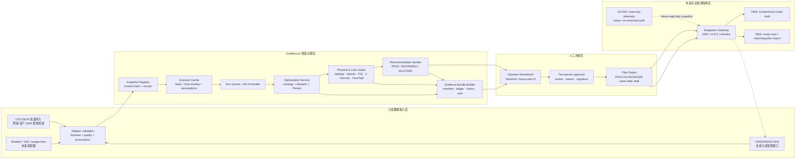

# GridRescue 可部署预案架构（Wave 8）

**范围：** 对 `app.py`、`src/gridrescue/{pipeline,scenarios,mrv,cli}.py`、现有 `flood_v08` 工件的只读架构评审；本文件不改动应用代码。  
**定位：** GridRescue 当前应被表述为**离线、人工审批的灾后恢复预案与证据生成系统**。它计算候选恢复计划、物理校验和碳—服务权衡，供调度/抢修人员评审；它**不**连接、不下发、不闭环控制真实 OMS、DMS 或 SCADA。

## 1. 当前原型可复用的部署资产

| 当前资产 | 架构角色 | 部署化处理 |
|---|---|---|
| `scenarios.py` 的灾害场景 | 场景输入 | 收敛为版本化 `ScenarioSnapshot`；每次运行固定 seed、时间窗与资产快照。 |
| `network.py` / `case33_data.py` | 网络模型 | 形成只读 `NetworkSnapshot`；目前仅含标准 case33bw 与工程假设。 |
| `pipeline.py`、`restoration.py`、`dispatch.py`、`powerflow.py` | 求解与物理门 | 封装为无状态 Optimization Worker；输出候选、失败码和物理证据。 |
| `care.py`、`islands.py` | 服务/成岛门 | 作为验证器，阻止未满足 CareTask、GFM、P/Q、电压或热限的候选进入推荐。 |
| `mrv.py` | 证据封存 | 延续 run manifest、factor snapshot、action ledger、claim gates、seal/verification。 |
| `app.py` | 审批工作台 | 只读取场景、运行状态与证据包；不持有控制凭证、不直接对外执行。 |

**建议的成熟度表述：** “可复算的预案级数字孪生/决策支持原型（标准算例、工程假设与合成场景）”，而不是“实时生产调度系统”。

## 2. 目标架构与安全边界



### 非谈判边界

1. **计划与控制解耦。** `Optimization Service` 输出计划草案，不产生遥控命令；`Plan Export` 只生成可审阅的数据包、工单草稿或 DMS study case。
2. **审批是独立状态机。** `DRAFT → VALIDATED → REVIEWED → APPROVED → EXPORTED → EXPIRED/REVOKED`；求解成功不等于获批准。
3. **输入快照不可变。** 每个运行只引用 hash 固定的网络、场景、因子、代码和 solver 配置；后续数据刷新只创建新 snapshot，不覆写历史。
4. **物理/服务 gate 前置。** 候选出现 `NO_GFM`、无源孤岛、欠压、过载、非径向、服务合同失败或求解/反馈未收敛时，状态为 `BLOCKED`，没有“推荐”出口。
5. **真实接口后置。** OMS/DMS/SCADA 在 P2 才允许进入受控网关；P0/P1 演示完全离线，无真实端点、账号或写回路径。

## 3. 运行形态

### A. P0 轻量笔记本 Demo（本版本推荐）

- 一个 Python 环境：现有 Streamlit UI + 本地 CLI/worker，使用本地 `artifacts/<scenario>/mrv/<run_id>` 只读展示。
- 预热并随包携带：`NetworkSnapshot`、3 个场景、固定 Pareto 结果、`run-7e495c4e6e73c188` 一类证据 bundle、失败反例。
- 本地目录分层：`inputs/`、`scenario-cache/`、`runs/`、`evidence/`、`exports/`；`inputs/` 与 `evidence/` 默认只读。
- 演示运行只允许创建新的 `runs/` 和 `exports/`；无网可完成“载入 → 推演 → 审批模拟 → 导出 → verify”。
- 失败降级：若实时计算超时，UI 回退到同一 snapshot 的已封存 run，并明确标记 `CACHED_REPLAY`；不可把缓存结果标成刚刚实时求解。

### B. P1 园区/脱敏馈线 PoV

- 将 worker 从 UI 进程剥离为本机或内网服务（REST/queue 均可）；UI 只提交 job、轮询状态、读取不可变产物。
- `Data Adapter` 将 CSV、GIS、停电/抢修清单、天气缓存映射成内部 canonical schema，保存原始文件 hash、字段映射、质量报告和拒绝记录。
- 使用关系数据库保存 metadata/approval/audit（例如 PostgreSQL），对象存储保存 CSV/JSON/PDF evidence；求解容器固定 Python、依赖 lock 和 solver version。
- 外部源在下载后缓存；计算只使用已批准 snapshot，避免 API 波动改变同一 run 的结果。

### C. P2 企业集成（路线图，不纳入当前承诺）

- 通过隔离 Integration Gateway 接 OMS/DMS/SCADA 的**只读**资产、拓扑、故障和遥测快照；采用每源最小字段、时间戳、质量码与来源版本。
- DMS/OMS 接收的是“switching-plan proposal / work-order draft”，必须由企业系统内的既有安全校核、调度规程和授权角色再次审批。
- SCADA 若未来需要数据，只允许单向/拉取式 read-only telemetry ingestion；遥控命令路径仍不在 GridRescue 范围内。
- 语义映射应预留 IEC CIM（IEC 61968/61970）对象映射；现场遥测/集成层可评估 OPC UA 或既有 utility gateway，但先以供应商接口与安全区划为准。

## 4. 核心接口合同

### 4.1 Canonical snapshot 与数据适配器

```json
{
  "snapshot_id": "net-20260822-001",
  "kind": "network|asset|outage|weather|factor|care_task",
  "schema_version": "gridrescue-input-1.0",
  "source": {"system": "csv_import", "source_ref": "file-or-record-id", "retrieved_at": "ISO-8601"},
  "effective_window": {"start": "ISO-8601", "end": "ISO-8601"},
  "data_class": "synthetic_demo|deidentified_pov|production_candidate",
  "quality": {"status": "accepted|quarantined|rejected", "missing_fields": [], "validation_errors": []},
  "content_sha256": "sha256:...",
  "payload_ref": "object://inputs/..."
}
```

**Adapter contract**

- 输入：原始文件/API 响应 + source metadata；每次接入保留原始 payload 或其受控引用。
- 输出：canonical snapshot、字段映射、单位转换、质量码、provenance、hash；禁止适配器直接调用求解或 export。
- 拒绝条件：未知单位/时区、重复或冲突 asset ID、拓扑断裂、未来时间戳、缺关键质量码、超过数据新鲜度策略。

### 4.2 场景缓存与运行提交

```json
{
  "run_request_id": "req-...",
  "network_snapshot": "sha256:...",
  "asset_snapshot": "sha256:...",
  "scenario": {"scenario_id": "flood-v08", "seed": 20260822, "horizon_h": 24},
  "constraints": {"care_contract": "sha256:...", "strategy_set": ["traditional", "eens", "carbon_resilient"]},
  "solver": {"engine_version": "gridrescue-0.1.0", "max_iterations": 8, "tolerance_kw": 0.10},
  "requested_by": "operator-id",
  "mode": "offline_planning"
}
```

- `Scenario Cache` key = canonical request JSON + all input hashes + code/solver/dependency digest.
- 命中时返回已验证的 `CACHED_REPLAY`，含原 `run_id`；未命中才新建 run。
- 禁止依赖系统当前时间、未固定随机数、在线天气调用或可变因子来影响 run。

### 4.3 Optimization / validation result

```json
{
  "run_id": "run-...",
  "status": "SUCCEEDED|FAILED|TIMEOUT|CANCELLED",
  "candidates": [{
    "candidate_id": "carbon_resilient",
    "recommendation_state": "PASS|DEGRADED|BLOCKED",
    "service_gate": "PASS|FAIL",
    "physical_gate": "PASS|FAIL",
    "claim_gate": "ELIGIBLE|INELIGIBLE",
    "failure_codes": ["NO_GFM", "VOLTAGE_LOW"],
    "artifacts_ref": "object://runs/..."
  }],
  "replay": {"run_manifest_sha256": "sha256:...", "seed": 20260822}
}
```

- 求解器不得吞掉异常并仅返回“无推荐”；必须输出阶段、异常类、输入 hash 与可重试性。
- 物理验证、CareTask、Carbon/MRV 等 gate 由独立模块计算并进入结果；UI 只渲染 gate，不自行判断。

### 4.4 审批与导出

```json
{
  "approval_id": "apr-...",
  "candidate_id": "...",
  "run_manifest_sha256": "sha256:...",
  "decision": "APPROVE|REJECT|REQUEST_REVIEW",
  "reason_code": "...",
  "operator_comment": "...",
  "reviewers": [{"subject_id": "...", "role": "planner|supervisor", "signed_at": "ISO-8601"}],
  "expires_at": "ISO-8601"
}
```

- 导出前必校验：`PASS` 服务/物理门、证据 seal verification、未过期审批、二人规则（P1 起）、当前 snapshot 没有被 superseded。
- `ExportPackage` 至少包含计划动作、影响资产、运行/审批 ID、输入 hash、失败/假设清单、撤销/失效条件；P0 仅导出 PDF/CSV/JSON，P2 才映射到 OMS/DMS 格式。

## 5. 确定性回放与证据 bundle

现有 MRV 模块已具备良好雏形：`run_manifest`、factor registry/snapshot、action/activity/emission ledger、claim gates、evidence index、seal 和 verification。部署化时把它升格为每个 run 的不可变合约。

**每个 Evidence Bundle 必含：**

1. `run_manifest.json`：输入 snapshot hashes、scenario/seed、代码 commit、Python/solver/依赖版本、开始/结束时间、状态。
2. `inputs/`：network、asset、outage/weather、CareTask、factor 的冻结引用或副本；网络/因子原文与数据等级保留。
3. `outputs/`：候选计划、dispatch、P/Q 潮流、components、CareTask、island passport、Pareto failures、action ledger、MRV 清单。
4. `evidence/`：claim gates、file hash index、seal、verification，以及对外 export 与其 hash。
5. `replay_command.txt`：同平台一条命令；不能在当前环境原样执行时，明确标出 dependency lock 与预期 hash。

**确定性规则：** 固定 RNG seed；稳定的输入行排序和 canonical JSON；浮点结果用容差比较、报告 solver/version；cache key 包含代码 digest；每次 re-run 比较 artifact hashes 与关键 KPI tolerance。若求解器存在数值多解，保留求解日志及确定性 tie-breaker。

## 6. 安全、隐私与审计

| 域 | P0/P1 控制 | P2 加强 |
|---|---|---|
| 身份与授权 | 本地账号或受控演示身份；角色分离为 viewer/planner/reviewer/exporter/admin。 | SSO/OIDC、MFA、短时 token、least privilege、break-glass 审计。 |
| 数据保护 | 演示包仅包含 case33/合成或脱敏数据；不含人员、客户、精确地理、真实设备凭证。 | 数据分级、字段级最小化、存储/备份加密、密钥托管、保留与删除策略。 |
| 完整性 | immutable run directory、hash index、seal verify、append-only approval/audit log。 | WORM/对象锁、签名、集中 SIEM、时间同步与告警。 |
| 网络与集成 | laptop demo 无外联依赖；导入文件 quarantine + schema scan。 | IT/OT 分区、DMZ gateway、mTLS、证书轮换、allowlist、协议/内容校验、单向 read-only telemetry。 |
| 供应链 | lockfile、SBOM、依赖漏洞扫描、release hash。 | 签名构件、受控镜像仓库、CI policy、独立安全评审。 |

**隐私边界：** 客户/医院的名称、地址、联系人、设备序列号和精细负荷曲线都不进入 demo、PPT 或公共 evidence bundle。PoV 使用 pseudonymous asset IDs；身份映射留在客户侧受控库，并通过最小字段 adapter 传递。

## 7. 失败处理与运行韧性

| 失败类 | 检测 | 系统动作 | 对 UI/导出的影响 |
|---|---|---|---|
| 数据质量失败 | schema、单位、时区、资产 ID、质量码校验 | quarantine snapshot；不建 run。 | 显示输入被拒和精确字段错误；无推荐。 |
| 外部源不可达/过期 | adapter health/freshness | 使用最后一份已批准缓存或中止。 | 标 `STALE_INPUT` / `OFFLINE_REPLAY`；禁止伪装实时。 |
| 求解超时/崩溃 | job watchdog、structured error | kill worker、保留日志和输入；可按 policy retry 一次。 | `TIMEOUT/FAILED`；可查看上次 verified run，禁止新的 export。 |
| 物理或服务 gate 失败 | validation/CareTask/island passport | 标候选 `BLOCKED`，保留 failure codes。 | 在比较和证据中显示，不能进审批。 |
| 证据 seal 不匹配 | export 前/后 verify | 冻结该 run、生成 integrity incident。 | `UNVERIFIED`，审批/export 均锁定。 |
| 审批过期或数据被 supersede | approval/state check | 自动失效并要求重审。 | 旧导出标 `EXPIRED`；不迁移审批。 |
| 集成 gateway 故障（P2） | health/mTLS/ack timeout | 停在 export queue；不重发未知状态写入。 | 显示交付待确认；绝不假定 OMS/DMS 已接收。 |

## 8. 分期路线图（P0/P1/P2）

### P0 — 比赛/笔记本 demo：必须实现或演示到位

- 离线模式 banner：`预案级 · 标准算例/合成输入 · 无实时控制` 常驻。
- 固定 `NetworkSnapshot + ScenarioSnapshot + FactorSnapshot + seed`，本地 scenario cache 与 run ID。
- 求解、物理、CareTask、MRV 三类 gate 明确可见；任何 failed run 均可下载/回放。
- Evidence Bundle、seal verify、`CACHED_REPLAY` 语义、输入/输出目录隔离。
- 人工审批模拟：至少 planner + reviewer 两个身份/签名字段，导出前展示审批与证据 hash。
- 导出 PDF/CSV/JSON；含说明“计划草案，不含遥控命令”。
- 录屏/现场备用：预封存推荐 run、blocked 反例和离线启动脚本。

### P1 — 脱敏 PoV：在 P0 稳定后

- 批量 CSV/GIS/weather/outage adapters + schema/data-quality/provenance report。
- 独立 optimization worker、job queue、数据库 metadata、对象存储 evidence、容器/lockfile/SBOM。
- RBAC、OIDC、二人审批、不可变审计、approval expiration/revocation。
- 可配置保留期、数据脱敏、对外导出模板，OMS work-order/DMS study-case **文件级**导出。
- 基准性能和容量数据基于实际测量报告，不对未测节点规模作承诺。

### P2 — 企业接口：前提是 OT/调度治理批准

- IT/OT DMZ 的 integration gateway、mTLS、证书管理、allowlist、完整审计和安全测试。
- CIM-oriented asset/topology/outage mapping；vendor-specific OMS/DMS connector；SCADA read-only telemetry snapshot。
- 由企业系统执行第二次运行态校核、调度规程审批和任何控制行为；GridRescue 持续保持“建议/证据”系统定位。
- 生产 SLO、灾备、渗透测试、变更管理、运营监测、模型/数据漂移治理。

## 9. Slide-ready wording

### 一句话架构定位

> GridRescue 不是自动遥控系统；它把灾后恢复从“临场经验”变成可复算、可审批、可导出的离线预案，并为未来 OMS/DMS 接口保留了安全边界。

### 三层架构页

> 底层用只读数据适配器把网络、灾情、资源和因子冻结成快照；中层在固定 seed 下生成候选并经过服务与物理双门；上层让人审批，再把带证据 hash 的计划草案导出。任何真实系统接口都在隔离网关之外，且当前版本没有控制通道。

### 为什么可信

> 每次推荐都有同一个身份证：输入 hash、场景 seed、solver 版本、物理校验、服务合同、碳账本和审批记录。复算失败、物理失败或证据封签失败的候选，系统会展示失败原因，而不是静默推荐。

### 为什么可落地但不越界

> 今天可以在一台离线笔记本上稳定演示；明天可替换为脱敏馈线数据和 worker 服务；后天才通过企业 DMZ 把审批后的计划草案交给 OMS/DMS。真实调度与遥控始终由既有生产系统和人类流程承担。

### 评委问“是否能接 SCADA？”

> 架构已预留只读遥测快照和 CIM/企业网关适配层；当前原型 deliberately stops at planning, validation, evidence, and human approval. That boundary is a safety and credibility feature, not a missing demo button.

## 10. 验收清单

- [ ] UI、PPT、README 同时标明“offline planning / no control path / synthetic or de-identified inputs”。
- [ ] 任一 run 从 run ID 可定位 manifest、inputs、outputs、claim gates、seal、verification 与 replay command。
- [ ] 时间、seed、factor、network、CareTask 与 solver 参数均进入 cache key 和 evidence manifest。
- [ ] `BLOCKED` 候选不可获批、不可导出为 OMS/DMS plan；失败代码可查。
- [ ] 导出包具有 snapshot/run/approval/evidence hash、有效期、假设与撤销条件。
- [ ] Laptop demo 在断网时可打开固定 run、显示 blocked 反例、完成审批模拟并导出。
- [ ] 公共演示和证据包不出现真实用户名、绝对路径、客户/患者/资产敏感信息。
- [ ] P2 接口材料明确为 future roadmap，未宣称已经接入或控制真实 OMS/DMS/SCADA。

## 11. 标准/接口参考（用于 P2 设计，不构成当前接入声明）

- IEC CIM family：IEC 61968（distribution management）与 IEC 61970（EMS/application integration）作为未来资产、拓扑、停电和计划语义映射的候选基础。
- OPC UA security architecture：作为未来工业数据通道的认证、加密、证书与审计设计参考之一。
- OpenFMB：可作为分布式能源/现场互操作性研究的参考；是否采用由实际 utility 架构、供应商接口与 OT 安全区划决定。

---

**结论：** 可信的部署故事不是“把 Streamlit 连到 SCADA”，而是先把现有确定性推演、物理 gate 和 MRV evidence 组织成一个离线、审批优先、可回放的 planning product。这样既让 GridRescue 看起来能够渐进部署，也不制造其已具备真实电网控制能力的错觉。
